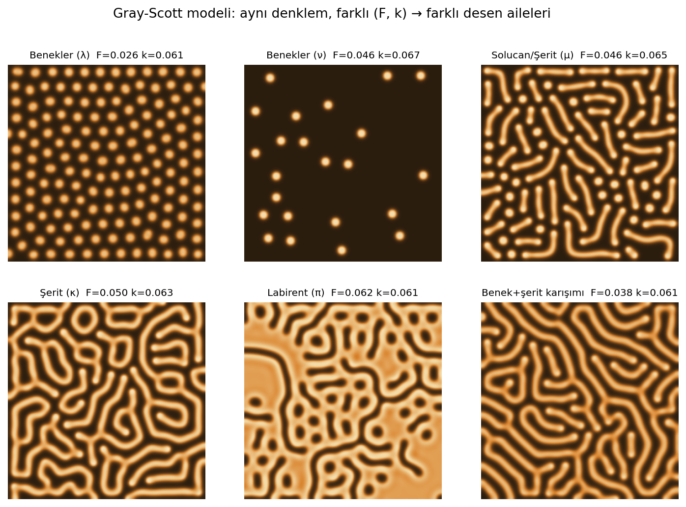
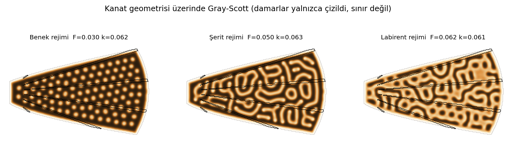
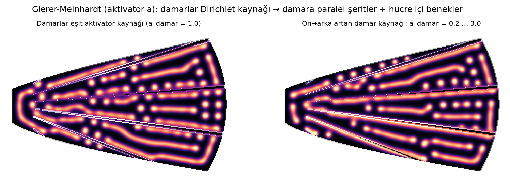
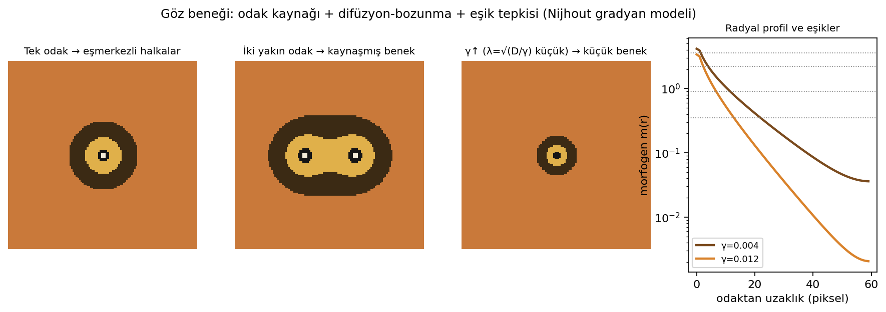
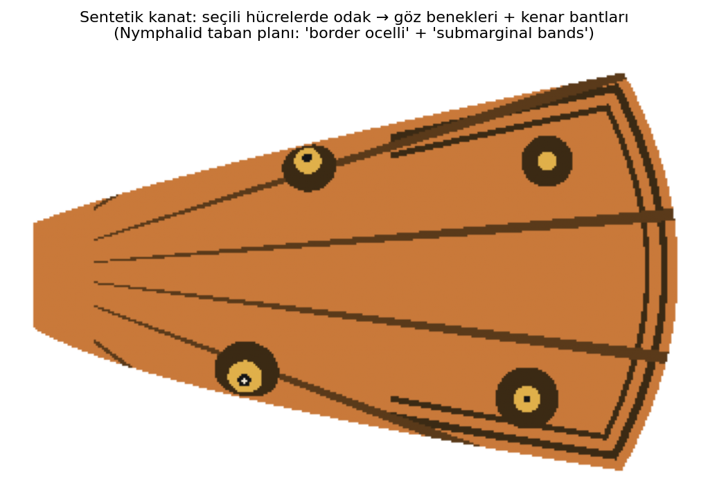

# Kelebek Kanat Desenlerinde Turing Morfogenezi
## Reaksiyon-difüzyon denklemlerinin sayısal simülasyonu ile desen üretimi ve Türkiye'deki gerçek kelebek türleriyle karşılaştırma

*TÜBİTAK 2204-A Lise Öğrencileri Araştırma Projeleri Yarışması için araştırma altyapısı — Matematik / Biyoloji disiplinler arası*
*Hazırlanma tarihi: 15 Eylül 2026*

---

## 1. Özet

Kelebek kanatlarındaki göz benekleri, bantlar ve benekler, doğadaki en iyi incelenmiş "kendiliğinden desen oluşumu" örneklerindendir. Alan Turing'in 1952'de önerdiği reaksiyon-difüzyon (RD) mekanizması, birbirine etki eden ve farklı hızlarda yayılan iki kimyasalın (aktivatör ve inhibitör) homojen bir dokuda kendiliğinden periyodik desenler üretebileceğini gösterir. Bu proje, (i) Gray-Scott ve Gierer-Meinhardt RD modellerini basit bir kanat geometrisi üzerinde sonlu farklar yöntemiyle çözerek benek, şerit ve labirent desenleri üretmeyi, (ii) Nijhout'un odak-kaynaklı gradyan modeli ile eşmerkezli halkalı göz beneklerini simüle etmeyi ve (iii) elde edilen desenleri Türkiye'de yaygın olarak görülen kelebek türlerinin kanat desenleriyle nitel ve nicel olarak karşılaştırmayı amaçlar. Ön simülasyonlar, tek bir denklem çiftinde yalnızca iki parametrenin (F, k) değiştirilmesiyle benekten labirente uzanan desen ailelerinin üretilebildiğini; odak kaynağının gücü ve morfogenin bozunma hızının göz beneğinin boyutunu ve halka sayısını belirlediğini; yakın iki odağın "kaynaşmış" benek ürettiğini göstermiştir. Bu sonuçlar, literatürdeki deneysel bulgularla (odak nakli, CRISPR *Distal-less* ve *WntA* mutantları) tutarlıdır.

**Anahtar kelimeler:** Turing deseni, reaksiyon-difüzyon, Gray-Scott, Gierer-Meinhardt, morfogen, göz beneği, Nymphalidae, Türkiye kelebekleri

---

## 2. Amaç ve Araştırma Soruları

Projenin amacı, kelebek kanat desenlerinin matematiksel bir modelle (reaksiyon-difüzyon denklemleri) üretilip üretilemeyeceğini sayısal deneylerle sınamak ve model çıktılarının Türkiye'de yaşayan türlerin gerçek desenlerine ne ölçüde benzediğini ölçmektir.

Araştırma soruları:

1. Aynı RD denklemi, yalnızca parametreleri değiştirilerek kelebeklerde görülen temel desen sınıflarını (benek, şerit/bant, labirent/ağ, göz beneği) üretebilir mi?
2. Kanat damarları ve kanat kenarı gibi geometrik sınırlar, desenin nerede ve hangi biçimde oluşacağını nasıl etkiler?
3. Göz beneğinin boyutu ve halka sayısı hangi model parametrelerine bağlıdır? Bu bağımlılık, doğadaki bireysel/mevsimsel değişkenlikle uyumlu mudur?
4. Simülasyon çıktıları ile Türkiye'deki seçilmiş türlerin kanat fotoğrafları arasında ölçülebilir (benek sayısı, halka oranları, benek/kanat alanı oranı) bir uyum var mıdır?

---

## 3. Giriş ve Literatür Özeti

### 3.1 Turing'in fikri: "Kimyasal morfogenez"

Turing (1952), *The Chemical Basis of Morphogenesis* makalesinde, homojen bir dokuda iki kimyasal maddenin (morfogen) hem birbirleriyle tepkimeye girip hem de farklı hızlarda difüze olmaları hâlinde, küçük rastgele dalgalanmaların büyüyerek kararlı, periyodik uzamsal desenlere dönüşebileceğini gösterdi. Bu "difüzyonla tetiklenen kararsızlık" (diffusion-driven instability), sezgiye aykırıdır: difüzyon normalde farkları yok eder, ama uygun koşullarda desen üretir.

Gierer ve Meinhardt (1972) bu mekanizmayı biyolojik olarak yorumlanabilir bir biçime soktu: **kendini güçlendiren, yavaş yayılan bir aktivatör** ile **aktivatör tarafından üretilen, aktivatörü baskılayan, hızlı yayılan bir inhibitör**. "Kısa menzilli aktivasyon + uzun menzilli baskılama" ilkesi, bugün Turing desenlerinin standart açıklamasıdır. Kondo ve Miura'nın (2010, *Science*) derlemesi, bu çerçevenin balık şeritlerinden memeli kürk desenlerine kadar birçok sistemde deneysel karşılığını özetler.

### 3.2 Nymphalid taban planı (ground plan)

Nijhout (1991), Nymphalidae familyasındaki kelebek kanat desenlerinin ortak bir "taban plan"ın (Nymphalid ground plan) türe özgü değişimleri olduğunu ortaya koydu. Taban plan, kanat tabanından kenara doğru sıralanan simetri sistemlerinden oluşur: bazal, merkezi ve kenar (border) simetri sistemleri; kenar sistemi içinde **göz benekleri (border ocelli)**, **parafokal elemanlar** ve **kenar altı bantlar (submarginal bands)** yer alır. Her desen elemanı, damarlarla sınırlanan "kanat hücreleri" içinde bağımsızca ifade edilir; türler arasındaki farklılık, hangi hücrede hangi elemanın ne boyutta çıktığıyla açıklanır. Otaki (2021), bu taban planın kendine benzer (fraktal) bir düzeni olduğunu ve her simetri sisteminin bant, benek veya göz beneği olarak ifade edilebileceğini öne sürer ([DOI](https://doi.org/10.3390/insects12010039)).

### 3.3 Göz benekleri: odak, gradyan, eşik

Nijhout'un (1978, 1980) klasik modelinde her göz beneği bir **odak (focus)** hücre grubundan başlar: pupa evresinin ilk saatlerinde odak bir morfogen salgılar, bu morfogen çevreye difüze olup bozunur, çevredeki epidermis hücreleri morfogen derişimine göre **eşik tepkisi** verip farklı pigmentler üretir. Böylece odak çevresinde eşmerkezli halkalar oluşur. Bu modelin deneysel dayanağı güçlüdür: odak hücreleri cerrahi olarak alındığında benek oluşmaz, başka yere nakledildiğinde orada ektopik benek oluşur (Nijhout 1980; French & Brakefield 1995). PubMed'den erişilen Monteiro vd. (2001) çalışması, *Bicyclus anynana*'da yakın iki odağın kaynaşmış beneklerinin dış hatlarının, iki difüzyon-bozunma gradyanının toplamıyla öngörülen eğriye uyduğunu göstererek gradyan hipotezini nicel olarak sınadı ([DOI](https://doi.org/10.1023/a:1010226223287)).

Dilão ve Sainhas (2004) iki difüzif morfogen ve üç difüzif olmayan pigment öncülünden oluşan bir RD modeliyle göz beneklerinin yapısını, mevsimsel plastisitesini ve mikro-cerrahi deneylerin sonuçlarını yeniden üretmiştir ([DOI](https://doi.org/10.1098/rspb.2004.2761)). Otaki (2011) ise "indüksiyon modeli" adını verdiği alternatifte, koyu halkanın yavaş ilerleyen bir dalga olarak yayıldığını ve parafokal elemanların aslında göz beneği halkalarının periyodik devamı olduğunu öne sürer ([DOI](https://doi.org/10.2108/zsj.28.817)).

### 3.4 Odak noktalarının seçimi ve damarların rolü

Neden bazı kanat hücrelerinde göz beneği oluşur, bazılarında oluşmaz? Nijhout (1990) kapsamlı modelinde damarları ve kanat kenarını morfogen kaynağı olarak ele almış, aktivatör-inhibitör dinamiğinin her hücrenin orta hattında bir odak "seçtiğini" göstermiştir. Sekimura, Venkataraman ve Madzvamuse (2015), sonlu elemanlar yöntemiyle Gierer-Meinhardt sistemini yedi kanat hücresinde çözerek, yalnızca **proksimal damardaki aktivatör kaynak gücünün** hücreden hücreye değişmesinin, göz beneği olan ve olmayan hücreleri gürbüz biçimde ayırmaya yettiğini gösterdi ([DOI](https://doi.org/10.1371/journal.pone.0141434)). Bu, deneysel olarak sınanabilir bir öngörüdür: benek oluşan hücrelerde damar boyunca aktivatör kaynak gücü daha düşük olmalıdır.

Sekimura vd. (2000), *Papilio dardanus*'un dişi polimorfizmini, geometrik olarak doğru bir kanat alanı üzerinde çözülen RD modelinin şerit-benzeri desenleriyle açıklamış; kanat şekli ve sınır koşullarının mod seçimini nasıl belirlediğini göstermiştir ([DOI](https://doi.org/10.1098/rspb.2000.1081)).

### 3.5 Genler ve morfogenler: modelin moleküler karşılığı

Son on yılda CRISPR-Cas9 ile yapılan çalışmalar RD modellerine moleküler bir zemin kazandırdı:

- **WntA**: Mazo-Vargas vd. (2017, *PNAS*), yedi Nymphalid türünde *WntA* kaybının simetri sistemlerini (şerit benzeri desenler) ortadan kaldırdığını ve türe göre farklı desen elemanlarını etkilediğini gösterdi ([DOI](https://doi.org/10.1073/pnas.1708149114)). Hanly vd. (2023, *Development*), *WntA*'nın reseptörü *frizzled2*'yi tanımladı ve *WntA*/*fz2* çiftinin pozitif/negatif geri besleme altında olduğunu, yani gerçek bir morfogen-reseptör ekseni oluşturduğunu gösterdi ([DOI](https://doi.org/10.1242/dev.201868)).
- **Distal-less (Dll)**: Connahs vd. (2019, *Development*), *B. anynana*'da *Dll* CRISPR mutantlarında hem eksik hem ektopik göz benekleri gözledi; Wnt ve Dpp'yi aday morfogen alan **Gray-Scott tipi bir RD modeli** bu karmaşık fenotipleri doğru biçimde yeniden üretti ([DOI](https://doi.org/10.1242/dev.169367)). Bu makale, bu projede kullanılan Gray-Scott modelinin doğrudan biyolojik gerekçesidir.
- **Gen ağı modeli**: Liao vd. (2021, *J. Theor. Biol.*), En, Hh, Ci, TGF-β ve Wg gen ürünlerini içeren bir matematiksel modelle *B. anynana*'nın beyaz-siyah-sarı halkalı göz beneğini üretti ve tek tek genlerin eksikliğinin *Vanessa atalanta* (Atalanta) gibi türlerdeki "eksik halkalı" benekleri açıklayabileceğini önerdi ([DOI](https://doi.org/10.1016/j.jtbi.2021.110898)). *V. atalanta* Türkiye'de yaygın olduğundan bu öngörü proje için doğrudan kullanılabilir.

### 3.6 Gray-Scott modeli ve Pearson sınıflandırması

Gray-Scott sistemi, iki parametreyle (besleme oranı F, öldürme oranı k) çok zengin desen çeşitliliği üreten en basit RD modelidir. Pearson (1993, *Science*) F-k düzlemini taramış ve desenleri Yunan harfleriyle sınıflandırmıştır (λ ve ν: benekler; μ, η, κ: solucan/şerit; π: labirent vb.). Munafo'nun genişletilmiş sınıflandırması bu parametre çiftlerini listeler ve bu projede seçilen değerler oradan alınmıştır.

### 3.7 Türkiye kelebek faunası

Türkiye, Avrupa'nın tamamına yakın sayıda kelebek türüne ev sahipliği yapar: Doğa Koruma Merkezi'nin *Türkiye'nin Kelebekleri Arazi Rehberi* (Baytaş, 2018) ülkede dağılım gösteren yaklaşık 377–380 gündüz kelebeği türü ve bunların 45–50 kadarının endemik olduğunu belirtir. *Türkiye'deki Kelebeklerin Kırmızı Kitabı* (Karaçetin & Welch, 2011, DKM) tehdit kategorilerini verir. Gözlem verileri için kelebekler.org ve TRAKEL gibi gönüllü kayıt platformları kullanılabilir; bu platformlar, öğrencilerin projede kullanacağı fotoğraf ve dağılım kayıtlarının kaynağı olabilir.

---

## 4. Yöntem

### 4.1 Matematiksel modeller

**(a) Gray-Scott modeli** — desen ailelerinin taranması için:

```
∂u/∂t = Du ∇²u − u v² + F (1 − u)
∂v/∂t = Dv ∇²v + u v² − (F + k) v
```
u: sürekli beslenen "besin", v: kendini çoğaltan "aktivatör". Du = 0.16, Dv = 0.08, Δt = 1, Δx = 1 (Sims/Pearson standart ölçeklemesi).

**(b) Gierer-Meinhardt modeli (doymuş aktivatör)** — damar kaynaklı desenler için:

```
∂a/∂t = Da ∇²a + ρ a² / [h (1 + κ a²)] − μa a + ρ0
∂h/∂t = Dh ∇²h + ρ a² − μh h
```
Da = 1, Dh = 30 (Dh/Da = 30 ≫ 1: Turing koşulu), μa = 1, μh = 1.5, κ = 0.05, ρ0 = 0.01, Δt = 0.005. Damar pikselleri Dirichlet sınırı olarak sabit aktivatör değerinde tutulur (Sekimura vd. 2015 yaklaşımı).

**(c) Odak-gradyan-eşik modeli (göz beneği)** — Nijhout 1978/1980:

```
∂m/∂t = D ∇²m − γ m + s(x)
```
s: odak hücrelerinde sabit kaynak; kararlı durumda 2B'de m(r) ~ K₀(r/λ), λ = √(D/γ) karakteristik yayılım uzunluğu. Hücreler m değerine göre eşiklerle (0.35, 0.9, 2.2, 3.6) beş pigment sınıfından birini seçer: zemin, ince koyu halka, altın halka, siyah disk, beyaz pupil.

### 4.2 Sayısal yöntem

Tüm modeller, 5 noktalı sonlu fark Laplace operatörü ve açık (explicit) Euler zaman adımıyla NumPy'de çözüldü. Kararlılık için D·Δt/Δx² < 0.25 koşulu gözetildi. Kanat alanı, tabanı dar ve dışa doğru açılan bir yelpaze biçiminde maske olarak tanımlandı; tabandan yayılan 6 damar 7 kanat hücresi oluşturur. Kanat dışı pikseller her adımda dinlenme durumuna sıfırlanır (Dirichlet). Tüm kod `kanat_turing.py` dosyasındadır; yalnızca `numpy`, `scipy`, `matplotlib` gerektirir ve bir dizüstü bilgisayarda ~1 dakikada çalışır.

Öğrencilerin geliştirmesi beklenen adımlar: (1) gerçek kanat fotoğrafından maske ve damar çıkarma (görüntü eşikleme), (2) sonlu elemanlar veya daha yüksek çözünürlük, (3) benek sayısı/alan oranı gibi ölçütlerle nicel karşılaştırma.

### 4.3 Karşılaştırma protokolü (Türkiye türleri)

Her tür için (i) kelebekler.org / TRAKEL / iNaturalist'ten en az 10 dorsal ve ventral kanat fotoğrafı toplanır, (ii) göz beneği sayısı, halka sayısı, benek çapı / kanat hücresi genişliği oranı ölçülür, (iii) aynı ölçütler simülasyon çıktısında hesaplanır, (iv) türün deseni Pearson sınıfına ve taban plan elemanına eşlenir.

---

## 5. Bulgular (ön simülasyonlar)

### 5.1 Aynı denklem, farklı desen aileleri (Şekil 1)



Gray-Scott modelinde yalnızca (F, k) değiştirilerek düzenli benekler (λ: F=0.026, k=0.061), seyrek benekler (ν: F=0.046, k=0.067), kısa solucan/şerit parçaları (μ), uzun şeritler (κ), labirent (π) ve benek-şerit karışımı desenler elde edildi. Bu, tek bir mekanizmanın kelebeklerdeki benek (ör. *Polyommatus icarus* alt yüzü), bant (ör. *Melitaea* ağ deseni) ve labirent benzeri (ör. *Melanargia* dama tahtası) desen sınıflarını kapsayabileceğini destekler.

### 5.2 Kanat geometrisinin etkisi (Şekil 2)



Aynı parametreler kanat maskesi üzerinde çözüldüğünde benekler kanat kenarına paralel dizilme eğilimi gösterdi; şeritler dar taban bölgesinde kenara paralel, geniş dış bölgede rastgele yönelimli oldu. Bu "sınır etkisi", Sekimura vd. (2000)'in *Papilio dardanus* için raporladığı kanat şekli–mod seçimi ilişkisiyle uyumludur.

### 5.3 Damarlar morfogen kaynağı olduğunda (Şekil 3)



Gierer-Meinhardt modelinde damarlar sabit aktivatör kaynağı olarak tanımlandığında damarlara paralel şeritler ve hücre ortasında benek dizileri oluştu. Damar kaynağı ön kenardan arka kenara artırıldığında, güçlü kaynaklı damarlar boyunca sürekli aktivatör şeridi oluşurken zayıf kaynaklı damarlar çevresinde boşluk kaldı. Bu, Nijhout'un (1990) "damarlar kaynak ise damar-paralel şeritler ve hücre ortası odaklar" öngörüsünü nitel olarak yeniden üretir. **Sınırlılık:** Bu ön çalışmada hücre içi Turing kararsızlığı açık olduğundan tek bir odak yerine benek dizileri oluşmuştur; Sekimura vd. (2015)'in "tek odak seçimi" sonucu için parametrelerin homojen durumun kararlı olduğu bölgeye çekilmesi ve yalnızca damar kaynağının deseni tetiklemesi gerekir. Bu, öğrenci projesi için doğal bir sonraki adımdır.

### 5.4 Göz beneği: halkalar, kaynaşma, boyut (Şekil 4)



Tek odaktan yayılan morfogen ve dört eşikle beyaz pupil–siyah disk–altın halka–ince koyu dış halka düzeni (Nymphalid göz beneğinin tipik yapısı, ör. *Maniola jurtina*, *Aglais io*) elde edildi. İki odak yakınlaştırıldığında halkalar kaynaşarak "8" biçimli tek bir benek oluşturdu; bu, Monteiro vd. (2001)'in *Spotty* mutantı ve odak nakli deneylerindeki gözlemle aynıdır. Bozunma hızı γ üç katına çıkarıldığında (λ = √(D/γ) √3 kat küçülür) benek çapı yaklaşık yarıya indi ve en dış halka kayboldu; bu, kuru/yağışlı mevsim formları arasındaki göz beneği boyutu farkının (Brakefield'in *B. anynana* çalışmaları) tek bir parametreyle modellenebileceğini gösterir.

### 5.5 Sentetik kanat (Şekil 5)



Seçili dört kanat hücresine farklı güçte odak yerleştirilip kenar altı bantlar eklendiğinde, Nymphalid taban planının "border ocelli + submarginal bands" düzenine benzeyen sentetik bir kanat elde edildi. Kaynak gücü farkı, aynı kanatta büyük ve küçük göz beneklerinin bir arada bulunmasını (ör. *Lasiommata megera*'da apikal büyük benek + küçük alt benekler) açıklar.

---

## 6. Türkiye Türleriyle Karşılaştırma Çerçevesi

Aşağıdaki türler, Türkiye'de yaygın ve fotoğraflanması kolay olmaları, ayrıca her birinin farklı bir desen sınıfını temsil etmesi nedeniyle önerilmektedir. Türkçe adlar Baytaş (2018) rehberindeki yaygın kullanımı izler; öğrencilerin arazi rehberinden doğrulaması önerilir.

| Tür (bilimsel) | Yaygın Türkçe ad | Familya | Baskın desen elemanı | Model / rejim | Ölçülecek nicelik |
|---|---|---|---|---|---|
| *Aglais io* (= *Inachis io*) | Tavus kelebeği | Nymphalidae | Dört büyük, çok halkalı göz beneği (ön ve arka kanat) | Odak-gradyan-eşik; büyük λ, yüksek kaynak | Halka sayısı, halka yarıçap oranları, benek/kanat alanı |
| *Maniola jurtina* | Çayır esmeri | Nymphalidae (Satyrinae) | Ön kanatta tek apikal göz beneği (beyaz pupilli) | Tek odak; kaynak gücü tek hücrede yüksek | Benek çapı / kanat hücresi genişliği |
| *Lasiommata megera* | Karamelek (duvar kelebeği) | Nymphalidae (Satyrinae) | Büyük apikal benek + arka kanatta küçük benek dizisi | Sekimura odak seçimi + değişken kaynak | Hücreye göre benek varlığı ve çapı |
| *Vanessa atalanta* | Atalanta | Nymphalidae | Kırmızı bant + eksik halkalı benekler | Liao vd. (2021) "eksik halka" öngörüsü | Halka eksikliği; bant genişliği |
| *Vanessa cardui* | Diken kelebeği | Nymphalidae | Arka kanat alt yüzünde küçük göz benekleri dizisi | Odak-gradyan, küçük λ | Benek sayısı ve dizilim aralığı |
| *Melitaea didyma* / *M. cinxia* | Benekli iparhan / Damalı iparhan | Nymphalidae | Turuncu zemin üzerinde siyah ağ (grid) deseni | Gray-Scott şerit/labirent rejimi + damar sınırı | Ağ hücre boyutu, damar-paralel şerit sayısı |
| *Melanargia galathea* / *M. larissa* | Orman melikesi / Anadolu melikesi | Nymphalidae (Satyrinae) | Siyah-beyaz dama tahtası + alt yüzde benekler | Labirent (π) rejimi, kenar-paralel modülasyon | Siyah/beyaz alan oranı |
| *Argynnis paphia* | Büyük inci | Nymphalidae | Turuncu zemin üzerinde düzenli siyah benek satırları | Benek (λ) rejimi, kanat kenarına paralel dizilim | Satır sayısı, benek aralığı |
| *Polyommatus icarus* | Çokgözlü mavi | Lycaenidae | Alt yüzde beyaz halkalı siyah benekler | Çok odak, küçük λ | Benek sayısı, halka/çekirdek oranı |
| *Parnassius apollo* | Apollo | Papilionidae | Arka kanatta kırmızı, siyah çerçeveli benekler | Odak-gradyan, iki morfogen (Dilão-Sainhas) | Kırmızı/siyah yarıçap oranı |

**Karşılaştırma ölçütleri (öğrencilerin hesaplayacağı):**
- Göz beneği için: halka yarıçapları r₁ < r₂ < r₃ ölçülür; modelde eşikler θᵢ ile r ilişkisi m(rᵢ) = θᵢ olduğundan ln(θᵢ) – rᵢ ilişkisinin yaklaşık doğrusal olması beklenir (üstel bozunma). Fotoğraftan ölçülen halkaların bu ilişkiyi ne ölçüde sağladığı, gradyan modelinin bir sınamasıdır.
- Benek dizileri için: ortalama komşu benek aralığının kanat hücresi genişliğine oranı; modeldeki Turing dalga boyu ile karşılaştırılır.
- Ağ/labirent desenleri için: siyah alan yüzdesi ve ortalama "hücre" boyutu; Gray-Scott'ta F–k taramasıyla eşleşen bölge aranır.

---

## 7. Tartışma

Ön simülasyonlar, projenin temel savını destekler: kelebek kanat desenlerinin ana sınıfları, az sayıda parametreyle kontrol edilen basit RD denklemlerinden türetilebilir. Literatürdeki en güçlü kanıtlar göz benekleri için mevcuttur; odak nakli deneyleri (Nijhout 1980), kaynaşmış benek geometrisi (Monteiro vd. 2001) ve *Dll* CRISPR fenotiplerinin Gray-Scott modeliyle açıklanması (Connahs vd. 2019) bir bütün oluşturur. Bant/şerit desenleri için *WntA*–*frizzled2* ekseni (Mazo-Vargas 2017; Hanly 2023) morfogen fikrini moleküler düzeyde doğrular.

Modelin sınırlılıkları: (1) Gerçek kanat büyürken desen oluşur; sabit alan varsayımı bir basitleştirmedir. (2) Pigment sentezi ve pul (scale) düzeyi ayrıklığı ihmal edilmiştir. (3) Parametreler biyolojik ölçülerle (μm, saat) değil boyutsuz birimlerle verilmiştir; ölçek kalibrasyonu için benek çapı – kanat boyu oranı kullanılabilir. (4) Damar kaynaklı Gierer-Meinhardt deneyinde tek odak seçimi henüz gösterilmemiştir (bkz. 5.3).

---

## 8. Öğrenci Projesi için Öneriler ve Yol Haritası

1. **Arazi/veri:** Bahar–yaz döneminde okul çevresinde (Büyükçekmece kıyı ve step alanları) *M. jurtina*, *L. megera*, *V. cardui*, *P. icarus* ve *M. didyma* gözlem ve fotoğrafı; kelebekler.org kayıtlarıyla desteklenmesi.
2. **Görüntü işleme:** Fotoğraflardan kanat maskesi ve damar ağı çıkarma (OpenCV eşikleme + iskelet); göz beneği halkalarının otomatik ölçümü.
3. **Simülasyon:** Gerçek maskede Gray-Scott ve odak-gradyan modeli; parametre taraması (F, k; D, γ) ve ölçütlere göre "en iyi uyum" arama.
4. **İstatistik:** Her tür için ölçülen ve simüle edilen halka oranlarının karşılaştırılması (ortalama ± SS, korelasyon).
5. **İleri aşama:** Sekimura'nın iki aşamalı odak seçim modelini uygulama; mevsimsel formları (λ değişimi) ve *Dll*/*WntA* mutant fenotiplerini (kaynak gücü sıfırlama) sanal olarak yeniden üretme.
6. **Etik/yasal:** Kelebekler yakalanmaz, yalnızca fotoğraflanır; korunan türler (ör. Apollo) için Kırmızı Kitap statüsü belirtilir.

---

## 9. Kaynakça

**Temel kuram**
- Turing, A. M. (1952). The chemical basis of morphogenesis. *Philosophical Transactions of the Royal Society B*, 237, 37–72.
- Gierer, A. & Meinhardt, H. (1972). A theory of biological pattern formation. *Kybernetik*, 12, 30–39.
- Pearson, J. E. (1993). Complex patterns in a simple system. *Science*, 261, 189–192.
- Kondo, S. & Miura, T. (2010). Reaction-diffusion model as a framework for understanding biological pattern formation. *Science*, 329, 1616–1620.
- Murray, J. D. (2003). *Mathematical Biology II: Spatial Models and Biomedical Applications* (3. baskı), Springer — Böl. 3 "Butterfly wing patterns".
- Munafo, R. — Pearson's classification (extended) of Gray-Scott parameter values: http://www.mrob.com/pub/comp/xmorphia/pearson-classes.html

**Kelebek kanat desenleri — modeller (PubMed üzerinden erişilen makaleler DOI bağlantılarıyla verilmiştir)**
- Nijhout, H. F. (1978). Wing pattern formation in Lepidoptera: a model. *J. Exp. Zool.*, 206, 119–136.
- Nijhout, H. F. (1980). Pattern formation on lepidopteran wings: determination of an eyespot. *Dev. Biol.*, 80, 267–274.
- Nijhout, H. F. (1990). A comprehensive model for colour pattern formation in butterflies. *Proc. R. Soc. B*, 239, 81–113. https://royalsocietypublishing.org/doi/10.1098/rspb.1990.0009
- Nijhout, H. F. (1991). *The Development and Evolution of Butterfly Wing Patterns*. Smithsonian Institution Press.
- Sekimura, T., Madzvamuse, A., Wathen, A. J. & Maini, P. K. (2000). A model for colour pattern formation in the butterfly wing of *Papilio dardanus*. *Proc. R. Soc. B*, 267, 851–859. https://doi.org/10.1098/rspb.2000.1081
- Monteiro, A., French, V., Smit, G., Brakefield, P. M. & Metz, J. A. (2001). Butterfly eyespot patterns: evidence for specification by a morphogen diffusion gradient. *Acta Biotheoretica*, 49, 77–88. https://doi.org/10.1023/a:1010226223287
- Dilão, R. & Sainhas, J. (2004). Modelling butterfly wing eyespot patterns. *Proc. R. Soc. B*, 271, 1565–1569. https://doi.org/10.1098/rspb.2004.2761
- Otaki, J. M. (2011). Generation of butterfly wing eyespot patterns: a model for morphological determination of eyespot and parafocal element. *Zoological Science*, 28, 817–827. https://doi.org/10.2108/zsj.28.817
- Sekimura, T., Venkataraman, C. & Madzvamuse, A. (2015). A model for selection of eyespots on butterfly wings. *PLoS ONE*, 10, e0141434. https://doi.org/10.1371/journal.pone.0141434
- Otaki, J. M. (2021). The fractal geometry of the Nymphalid groundplan: self-similar configuration of color pattern symmetry systems in butterfly wings. *Insects*, 12(1), 39. https://doi.org/10.3390/insects12010039
- Liao, K.-L., Chang, W.-C., Marcus, J. M. & Wang, J.-N. (2021). Mathematical modeling of the eyespots in butterfly wings. *J. Theor. Biol.*, 531, 110898. https://doi.org/10.1016/j.jtbi.2021.110898

**Genetik ve moleküler kanıt**
- Mazo-Vargas, A. vd. (2017). Macroevolutionary shifts of WntA function potentiate butterfly wing-pattern diversity. *PNAS*, 114, 10701–10706. https://doi.org/10.1073/pnas.1708149114
- Deshmukh, R. vd. (2018). Mimicry in butterflies: co-option and a bag of magnificent developmental genetic tricks. *WIREs Dev. Biol.*, 7, e291. https://doi.org/10.1002/wdev.291
- Connahs, H. vd. (2019). Activation of butterfly eyespots by Distal-less is consistent with a reaction-diffusion process. *Development*, 146, dev169367. https://doi.org/10.1242/dev.169367
- Van Belleghem, S. M. vd. (2020). Perfect mimicry between *Heliconius* butterflies is constrained by genetics and development. *Proc. R. Soc. B*, 287, 20201267. https://doi.org/10.1098/rspb.2020.1267
- Hanly, J. J. vd. (2023). Frizzled2 receives WntA signaling during butterfly wing pattern formation. *Development*, 150, dev201868. https://doi.org/10.1242/dev.201868

**Türkiye kelebekleri**
- Baytaş, A. (2018). *Türkiye'nin Kelebekleri Arazi Rehberi*. Doğa Koruma Merkezi, Ankara. https://dkm.org.tr/tr/turkiyenin-kelebekleri-arazi-rehberi
- Karaçetin, E. & Welch, H. J. (2011). *Türkiye'deki Kelebeklerin Kırmızı Kitabı*. Doğa Koruma Merkezi, Ankara.
- Buğday Derneği. Türkiye'nin kelebeklerini tanıyalım ve koruyalım. https://www.bugday.org/blog/turkiyenin-kelebeklerini-taniyalim-ve-koruyalim/
- Kelebek Gözlem Kayıtları — https://www.kelebekler.org ; TRAKEL — https://www.trakel.org ; AdaMerOs — http://adamerkelebek.org

---

## Ek: Dosyalar

- `kanat_turing.py` — tüm simülasyonlar (Gray-Scott, Gierer-Meinhardt, göz beneği, sentetik kanat). `python kanat_turing.py` ile çalışır; şekilleri `cikti/` klasörüne yazar.
- `sekiller/01…05.png` — bu rapordaki şekiller.
