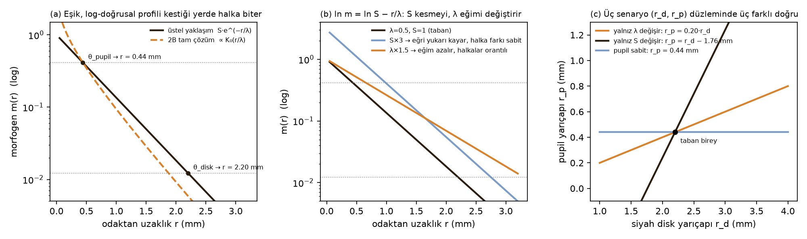
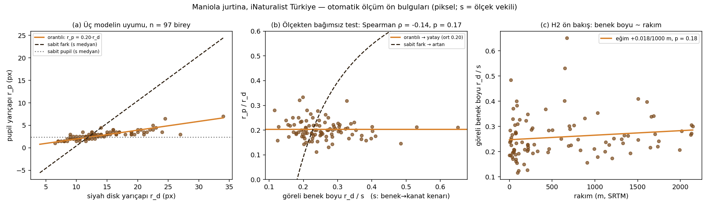
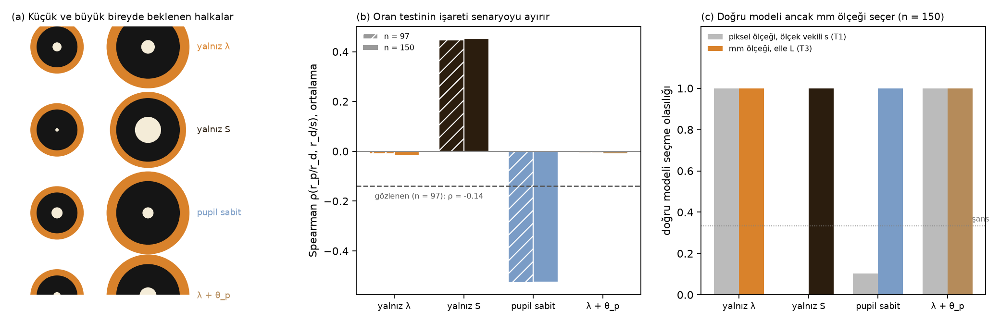
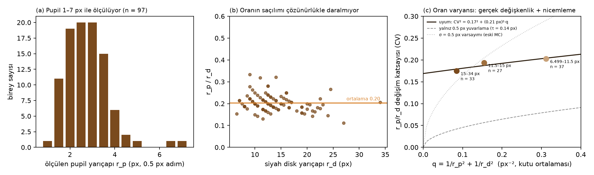

# Türkiye Kelebeklerinde Göz Beneği Geometrisi Turing Tipi Gradyan Modelinin Öngörülerini Doğruluyor mu?

**TÜBİTAK 2204-A Lise Öğrencileri Araştırma Projeleri Yarışması — Araştırma Raporu (Taslak v2)**
Alan: Matematik (Biyoloji ile disiplinler arası) · Sürüm tarihi: 7 Ekim 2026
Durum: ön analiz (otomatik hat, n = 97), Monte Carlo güç analizi ve Ek A lisans listesi tamamlandı; elle ölçekli ana analiz, *Aglais io* ve iklim eşlemesi **[DOLDURULACAK]** olarak işaretlidir.

> Köşeli parantez içindeki **[DOLDURULACAK — …]** notları öğrencilerin kendi ölçümleriyle tamamlayacağı yerleri gösterir. Bu bölümler doldurulmadan rapor "bulgu" olarak sunulmaz. Yapay zekâ desteğiyle üretilen kod ve metinler §5.7'de beyan edilmiştir.

---

## 1. Özet

**Amaç.** Kelebek kanatlarındaki göz benekleri, Turing'in (1952) reaksiyon-difüzyon fikrinin en bilinen biyolojik örneğidir. Nijhout'un gradyan modeline göre benek, bir odaktan yayılan kimyasal sinyalin (morfogen) uzaklaştıkça azalmasıyla oluşur; her halka, sinyalin belirli bir eşiğin altına düştüğü yerde biter. Bu modelde benek boyutunu iki parametre belirler: sinyalin **ne kadar güçlü** salgılandığı (S) ve **ne kadar uzağa** yayılabildiği (λ). Halka yarıçapı için kapalı biçimli çözüm r_i = λ·ln(S/θ_i)'dir. Projenin sorusu şudur: Türkiye'deki Çayır esmeri (*Maniola jurtina*) bireyleri arasındaki benek farkları bu iki parametreden hangisinden kaynaklanıyor ve bu, ölçeği bilinmeyen fotoğraflardan hangi istatistikle ayırt edilebilir?

**Yöntem.** Model, iki parametre için farklı izler bırakır: yalnız S değişirse pupil ile siyah disk arasındaki mesafe sabit kalır; yalnız λ değişirse tüm halkalar aynı oranda büyür. iNaturalist'teki 390 Türkiye kaydından (0–2144 m) yazdığımız görüntü işleme hattıyla 97 bireyde pupil ve disk yarıçapını ölçtük. Fotoğraf yakınlaştırmasının yarattığı ölçek sorununu aşmak için ölçekten bağımsız bir oran testi kullandık ve testlerin güvenilirliğini Monte Carlo benzetimiyle sınadık.

**Bulgular.** Monte Carlo, piksel ölçeğindeki doğrudan karşılaştırmanın yanıltıcı olduğunu, oran testinin ise iki senaryoyu %94'ün üzerinde güçle ayırdığını gösterdi. Gerçek veride "yalnız S değişir" senaryosunun öngördüğü ilişki gözlenmedi (ρ = −0.14, beklenen +0.40); pupil/disk oranının dağılımı (CV %19) ise "yalnız λ değişir" senaryosunun öngördüğü değerle (%21) örtüştü. Rakımla anlamlı bir ilişki bulunmadı (p = 0.18).

**Sonuç.** *M. jurtina*'da göz beneği halkaları birlikte ölçekleniyor; bireyler arasındaki fark sinyalin gücünden çok yayılma uzunluğundan kaynaklanıyor görünüyor. Bu ön bulgudur: pupil yalnızca 1–7 piksel genişliğinde ölçülebildiğinden "pupil sabit" modeli henüz dışlanamamıştır ve kesin ayrım için fotoğraflarda kanat uzunluğunun elle ölçülmesi gerekir **[DOLDURULACAK — ana veri: n, cinsiyet, ICC, *A. io*, iklim]**. Çalışma, bir gelişim modelinin öngörülerinin vatandaş bilimi fotoğraflarıyla sınanabileceğini ve bunun için hangi testin güvenilir olduğunu göstermektedir.

**Anahtar kelimeler:** Turing deseni, reaksiyon-difüzyon, morfogen gradyanı, göz beneği, *Maniola jurtina*, vatandaş bilimi, iNaturalist, Monte Carlo

---

## 2. Amaç ve Araştırma Soruları

**Amaç:** Göz beneği oluşumunu betimleyen difüzyon–bozunma denkleminin kararlı durum çözümünden, bireyler arasında *ölçülebilir* ve *birbirini dışlayan* öngörüler türetmek; bu öngörüleri Türkiye'deki doğal *Maniola jurtina* popülasyonunda ölçülen halka yarıçaplarıyla istatistiksel model karşılaştırmasıyla sınamak ve modelin hangi parametresinin (λ, S, θ) bireyler arasında değiştiğini belirlemek.

**Araştırma soruları**
1. Denklemin çözümü r_i = λ·ln(S/θ_i) olduğuna göre, parametrelerden yalnız biri değiştiğinde halka yarıçapları arasında hangi fonksiyonel ilişki beklenir ve bu ilişkiler veriden ayırt edilebilir mi?
2. Fotoğraf ölçeğinin (px/mm) bilinmediği bir veri setinde hangi istatistik ölçekten bağımsızdır; bu istatistiğin gücü ve yanlış pozitif oranı nedir?
3. Yayılım uzunluğu λ = √(D/γ) rakım ve sıcaklıkla değişiyor mu?

---

## 3. Giriş

### 3.1 Difüzyonla desen: Turing'in matematiksel fikri
Turing (1952), iki maddenin derişimlerini betimleyen bir kısmi diferansiyel denklem sistemine difüzyon terimi eklenince, tek başına kararlı olan homojen çözümün **kararsızlaşabileceğini** gösterdi: küçük rastgele sapmalar belirli dalga boylarında büyür ve periyodik desen oluşur ("difüzyonla tetiklenen kararsızlık"). Bu sonuç doğrusallaştırma ve Fourier analiziyle elde edilir; kararsızlık koşulu, iki maddenin difüzyon katsayılarının oranına bağlıdır (Gierer & Meinhardt 1972; Murray 2003). Gray–Scott sistemi gibi iki parametreli basit modeller, yalnız (F, k) değiştirilerek benek, şerit ve labirent desenleri üretir (Pearson 1993); bu desen ailelerini kanat geometrisi üzerinde sayısal olarak ürettiğimiz ön çalışma ekteki literatür raporundadır (`ARASTIRMA_RAPORU.md`, `kanat_turing.py`).

### 3.2 Göz beneği için daha yalın bir model: tek kaynaklı difüzyon–bozunma
Göz benekleri için Turing kararsızlığına gerek yoktur; Nijhout (1978, 1980) her beneğin, bir **odak** noktasından salgılanan tek bir maddenin yayılıp bozunmasıyla oluştuğunu önerdi:

  ∂m/∂t = D ∇²m − γ m + s(x),

burada m morfogen derişimi, D difüzyon katsayısı, γ bozunma hızı, s(x) odakta yoğunlaşmış kaynaktır. Hücreler m'nin değerine **eşik** kuralıyla tepki verir: m > θ_i ise i. pigment. Bu modelin biyolojik dayanağı güçlüdür: odak hücreleri alınınca benek oluşmaz, nakledilince nakil yerinde oluşur (Nijhout 1980; French & Brakefield 1995); Monteiro vd. (2001) yakın iki odağın kaynaşmış beneklerinin dış hattının iki çözümün toplamına uyduğunu nicel olarak göstermiştir (doi:10.1023/a:1010226223287). Son yıllarda bu "morfogen"in moleküler karşılıkları da bulunmuştur (Connahs vd. 2019; Hanly vd. 2023); ancak bu proje için önemli olan, modelin **matematiksel yapısının** ürettiği öngörülerdir (§4).

### 3.3 Modele itirazlar ve ölçekleme literatürü
Otaki (2011a), aynı kanattaki farklı boyuttaki beneklerde halka oranlarının sabit olmadığını göstererek tek-morfogenli modelin yetersiz kaldığını savunmuştur (doi:10.2108/zsj.28.403). Monteiro vd. (1997) *Bicyclus anynana*'da halka oranlarının eşikler (θ) üzerinden, benek boyutunun ise odak sinyali üzerinden kalıtıldığını bulmuştur (doi:10.1111/j.1558-5646.1997.tb03968.x). Ölçekleme konusunda iki yakın çalışma vardır: Palmer, McKenna & Nijhout (2019) *Junonia coenia*'da benek çaplarının kanat boyuyla **izometrik** (allometri katsayısı ≈ 1) ölçeklendiğini bulmuş ve bunu difüzyon modelinden beklenmeyen bir sonuç olarak nitelemiştir (doi:10.1093/icb/icz123); Mowbray vd. (2024) *M. jurtina*'da ön kanat beneğinin kanat uzunluğuyla ölçeklendiğini göstermiştir (doi:10.1002/ece3.10842). Bu çalışmaların hiçbiri **halka oranlarını** bireyler arasında karşılaştırmamış, yani modelin hangi parametresinin değiştiğini sormamıştır.

### 3.4 Türkiye faunası ve çalışılan tür
Türkiye'de yaklaşık 380 gündüz kelebeği türü yaşar (Baytaş 2018; Karaçetin & Welch 2011). **Çayır esmeri *Maniola jurtina***: ön kanat apeksinde beyaz pupilli tek büyük siyah benek; 0–2000 m; Mayıs–Eylül; iNaturalist'te bol kayıt. İkinci tür **Tavus kelebeği *Aglais io*** (3–4 halka; λ–S ayrımı için daha güçlü). **[Ö3: 1 sayfalık biyoloji notu — cinsiyet ayrımı, fenoloji.]**

### 3.5 Bilgi boşluğu ve katkı
Katkımız matematikseldir: (i) kararlı durum çözümünden üç rakip senaryo için kapalı biçimli öngörüler türetmek; (ii) ölçeğin bilinmediği fotoğraf verisinde hangi istatistiğin **ölçek dönüşümü altında değişmez** olduğunu göstermek; (iii) bu istatistiklerin gücünü Monte Carlo ile ölçmek; (iv) öngörüleri Türkiye popülasyonunda sınamak.

---

## 4. Kuramsal Çerçeve ve Hipotezler

### 4.1 Kararlı durum çözümü
Odak çevresinde dairesel simetri varsayılırsa kararlı durumda (∂m/∂t = 0), odak dışında

  D (m'' + m'/r) − γ m = 0,

ki bu değiştirilmiş Bessel denklemidir; sonlu kalan çözüm m(r) = A·K₀(r/λ), **λ = √(D/γ)**. Büyük r için K₀(x) ≈ √(π/2x)·e^(−x) olduğundan uygulamada m(r) ≈ S·e^(−r/λ) yaklaşımı kullanılır (Şekil 1a). λ, denklemin tek uzunluk ölçeğidir: D [mm²/s] ve γ [1/s] birleşince mm birimli tek bir büyüklük verir (boyut analizi). Hücre m > θ_i ise i. pigmenti seçtiğinden i. halkanın yarıçapı

  **r_i = λ · ln(S / θ_i)**   (1)

olur. Log ölçekte (Şekil 1b) ln m = ln S − r/λ bir doğrudur: S kesme noktasını, λ eğimi belirler.

### 4.2 Tanımlanabilirlik
(1)'de S ve θ_i yalnız ln(S/θ_i) oranı içinde görünür; dolayısıyla halka yarıçaplarından λ ve her i için ln(S/θ_i) kestirilebilir, fakat S ile θ_i ayrı ayrı kestirilemez (yapısal tanımlanamazlık). İki halkanın oranı

  r_p / r_d = ln(S/θ_p) / ln(S/θ_d)   (2)

λ'dan bağımsızdır; farkı ise

  r_d − r_p = λ · ln(θ_p/θ_d)   (3)

S'den bağımsızdır. Bu iki özdeşlik, hipotezlerimizin kaynağıdır.

### 4.3 Üç senaryo, üç öngörü (Şekil 1c)
Bireyler arasında yalnız bir parametre değişiyorsa:
- **Yalnız S değişir** → (3) gereği r_d − r_p sabittir: (r_d, r_p) düzleminde eğimi 1 olan doğru. Küçük beneklerde pupil küçülür; S < θ_p olduğunda kaybolur.
- **Yalnız λ değişir** → (2) gereği r_p/r_d sabittir: orijinden geçen doğru. Tüm halkalar aynı çarpanla ölçeklenir.
- **Pupil kaynak hücrelerinin kendisidir** (eşik halkası değil) → r_p sabit, r_d değişken: yatay doğru.
Eşiklerin S ile eşgüdümlü kayması (θ_i ∝ S) da (2)'yi sabit tutar; bu nedenle "orantılı" bulgusu λ-değişimi **veya** eşdeğer bir ölçekleme mekanizması anlamına gelir (§7).

### 4.4 Ölçek dönüşümü altında değişmezlik
Fotoğrafta ölçülen yarıçaplar r_px = μ·r_mm'dir; μ (px/mm) fotoğraftan fotoğrafa değişir ve bilinmez. Oran r_p/r_d, μ'dan bağımsızdır; fark r_d − r_p ise μ ile çarpılır. Dolayısıyla piksel ölçeğinde r_p ile r_d arasındaki doğrusal ilişki, mekanizma ne olursa olsun μ'nun değişkenliğinden dolayı orantılı görünür — bu, §6.3'te sayısal olarak doğrulanan bir yanılgıdır. Ölçekten bağımsız test şudur: göreli benek boyu r_d/s (s: aynı fotoğraftan alınan bir uzunluk vekili, μ sadeleşir) ile r_p/r_d arasındaki korelasyonun **işareti** — yalnız λ → 0; yalnız S → pozitif (çünkü (2)'de pay, paydaya göre daha hızlı büyür); pupil sabit → negatif.

### 4.5 Hipotezler
**H1 (ölçekleme):** Hangi senaryo veriyle uyumlu? (T1) piksel ölçeğinde üç kısıtlı modelin AIC karşılaştırması [kontrol amaçlı]; (T2) Spearman ρ(r_p/r_d, r_d/s); (T3) elle ölçülen kanat uzunluğu L ile mm ölçeğinde kısıtlı modellerin AIC'si.
**H2 (coğrafya):** λ'nın vekili (r_d/L) rakım ve aylık sıcaklıkla ilişkili mi? D ve γ sıcaklığa bağlı hız sabitleri olduğundan λ'nın da sıcaklığa bağlı olması beklenir.
**H0 (yöntem):** Testlerin ölçüm gürültüsü altındaki gücü ve yanlış pozitif oranı Monte Carlo ile belirlenir (§5.6).

*Şekil 1. Gradyan modelinin matematiği. (a) Kararlı durum profili log ölçekte: üstel yaklaşım ve 2B tam çözüm K₀ (pupil yarıçapında çakıştırılmış); eşikler θ profili kestiği yerde halka sınırını verir. (b) ln m = ln S − r/λ: S'nin değişmesi doğruyu dikey kaydırır (halka farkı sabit), λ'nın değişmesi eğimi değiştirir (halkalar orantılı). (c) Üç senaryonun (r_d, r_p) düzlemindeki öngörüleri; taban birey r_d = 2.2 mm, r_p = 0.44 mm.*

---

## 5. Yöntem

### 5.1 Veri kaynağı
iNaturalist API, "research grade", Türkiye (place_id 7183), fotoğraflı gözlemler (`inat_cek.py`). Rakım her kayda SRTM (Open-Elevation) ile eklendi.

| Tür | Gözlem | Fotoğraf | Lisans (CC / lisanssız) | Rakım medyan | >1000 m | >1500 m | Aralık | Ay yoğunluğu |
|---|---|---|---|---|---|---|---|---|
| *Maniola jurtina* | 390 | 508 | 300 / 90 (%77 CC) | 108 m | 55 | 27 | 0–2144 m | May 102, Haz 133, Tem 65, Ağu 36, Eyl 43 |
| *Aglais io* | 105 | 152 | 85 / 20 (%81 CC) | 467 m | 35 | 13 | 0–2788 m | Mar–Tem |

*M. jurtina* kayıtlarının %67'si 2022–2026 yıllarına aittir. Yalnız CC lisanslı fotoğraflar (çoğu CC-BY-NC) analize girer; lisanssız olanlar kullanılmaz ve raporda gösterilmez. **[Ö3: her kayıt için MGM/WorldClim aylık ortalama sıcaklık eşlemesi.]**

### 5.2 Otomatik benek ölçümü (`benek_olc.py`, `hat.py`)
Koyu, dairesel, merkezinde parlak pupil bulunan ve çevresi sıcak tonlu kanat zemini olan lekeler aday alınır; skorlama ile en iyi aday seçilir. Merkezden 0.5 px adımla 180 açı üzerinde parlaklık (L*) ve doygunluk profili çıkarılır; pupil sınırı ilk keskin düşüşün yarı-yükseklik noktası, disk sınırı sonraki keskin yükselişin yarı-yükseklik noktasıdır. Geçerlilik ölçütleri: pupil var, disk parlaklığı < 70, r_d ≥ 6 px, pupil–disk kontrastı > 90. Her fotoğraf için teşhis görseli üretilir (`veri/teshis_ornek/`) ve öğrenci doğrulamasından geçer. Altın/turuncu halka (r_g) *M. jurtina*'da güvenilir değildir (turuncu alan halka değil geniş yamadır); *A. io* için LAB b-kanalı tabanlı çok halkalı modül yazılacaktır **[Danışman]**.

### 5.3 Ölçek ve cinsiyet
Ön analizde ölçek vekili olarak benek merkezinden en yakın kanat kenarına uzaklık s (GrabCut silüeti + uzaklık dönüşümü, `silhuet_olcek.py`) kullanıldı. Aynı bireyin farklı fotoğraflarında r_d/s için ICC = 0.30 (birey-içi CV %22) bulundu; bu vekil gürültülüdür ve §6.3'te gösterildiği gibi mm ölçeğine çevrilemez. Ana analizde ön kanat uzunluğu L (taban–apeks, px) her fotoğrafta elle işaretlenir ve tür/cinsiyet ortalaması L_mm (♂ ~22 mm, ♀ ~25 mm; **[Ö3: literatürden doğrulanacak]**) ile mm'ye çevrilir. Cinsiyet: ön analizde vekil olarak silüet içindeki turuncu alan oranı; ana analizde **[Ö3 ölçütleriyle]** görsel etiket. **[Ö2: işaretleme aracı; 30 fotoğrafta iki bağımsız ölçücü, ICC > 0.8 hedefi; dahil etme: dik açı, elipslik < 1.15, benek bütün, aşınma yok.]**

### 5.4 İstatistik (`analiz.py`)
Birey başına tek fotoğraf. H1: (T1) r_p ~ r_d + s OLS ve üç kısıtlı model — orantılı r_p = β·r_d; sabit fark r_d − r_p = κ·s; sabit pupil r_p = κ'·s — aynı bağımlı değişken üzerinden AIC; (T2) Spearman ρ(r_p/r_d, r_d/s); (T3) mm ölçeğinde aynı üç model. H2: OLS r_d/s ~ rakım + cinsiyet vekili + ay. Python 3.11; NumPy, SciPy, pandas, statsmodels, OpenCV, Matplotlib.

### 5.5 Sayısal çözüm (`kanat_turing.py`)
Denklem, 5 noktalı sonlu fark Laplace operatörü ve açık (explicit) Euler zaman adımıyla çözülür: m^{n+1} = m^n + Δt·(D·∇²_h m^n − γ m^n + s). Kararlılık için D·Δt/Δx² < 1/4 koşulu sağlanır (kullanılan: D = 1, Δx = 1, Δt = 0.2 → 0.2). Sentetik benekler, Monte Carlo'da ölçüm hattını bilinen λ ve S ile sınamak için üretilir.

### 5.6 Monte Carlo güç analizi (`monte_carlo.py`)
Üç senaryoda gradyan modeliyle sentetik benekler üretildi (taban: λ₀ = 0.5 mm, ln(S/θ_d) = 4.4 → r_d = 2.2 mm, ln(S/θ_p) = 0.88 → r_p/r_d = 0.20; r_d'nin bireyler arası CV'si 0.20, duyarlılık için 0.12 ve 0.30). Ölçüm gürültüsü gerçek hattı taklit eder: fotoğraf çözünürlüğü px/mm ~ log-normal(5.7, σ = 0.40); yarıçaplara ±0.5 px gürültü ve 0.5 px nicemleme; ölçek vekili s'ye ICC ≈ 0.31 verecek gürültü; elle L'ye %5 işaretleme hatası ve bireysel L yerine tür ortalaması kullanımından doğan ~%7 hata; hattın geçerlilik filtresi (r_d ≥ 6 px, pupil ≥ 1 px). n = 97 ve 150, 400 tekrar. Her tekrarda T1, T2 ve T3 uygulandı; doğru modeli seçme olasılığı ve T2'nin güç/yanlış pozitif oranı hesaplandı.

### 5.7 Araçlar ve beyan
Simülasyon, veri çekme, otomatik ölçüm ve Monte Carlo betikleri danışman gözetiminde yapay zekâ destekli geliştirildi ve açık paylaşılır. Ölçümlerin görsel doğrulanması, ölçek ve cinsiyet etiketleri **öğrenciler tarafından elle** yapılır; öğrencilerin kendi elleriyle yapmadığı hiçbir ölçüm "bulgu" olarak sunulmaz. Hiçbir kelebek yakalanmamış veya zarar görmemiştir.

---

## 6. Bulgular

### 6.1 Hattın verimi
395 CC lisanslı *M. jurtina* fotoğrafı → 249 otomatik benek tespiti (%63) → 154 geçerli benek (%39) → silüet ölçeği ve geometri filtresi (s/r_d ∈ 1.5–9) → birey başına tek fotoğraf → **n = 97 birey**. Toplam süre ~1 saat. Rakım katmanları: 0–200 m 39, 200–800 m 26, 800–1500 m 17, >1500 m 15 birey. Ölçülen pupil yarıçapı medyan 2.5 px (1–7 px), disk yarıçapı medyan 12.5 px (6.5–34 px); pupil 0.5 px adımla ölçüldüğünden nicemleme hatası baskındır (Şekil 4a).

### 6.2 Ön analiz, piksel ölçeğinde (T1 ve T2)

*Şekil 2. (a) r_p–r_d ilişkisi ve üç kısıtlı model; (b) ölçekten bağımsız oran testi; (c) göreli benek boyu r_d/s ile rakım. n = 97 birey, piksel ölçeği, s = ölçek vekili.*

- Tam regresyon: r_p = 0.40 + 0.151·r_d + 0.005·s (r_d: p < 0.001; s: p = 0.12).
- T1 kısıtlı modeller: orantılı β = 0.196, AIC −105; sabit fark AIC +263; sabit pupil AIC −7.5. **Bu karşılaştırma Monte Carlo'ya göre geçersizdir** (§6.3): piksel ölçeğinde r_p ve r_d ikisi de fotoğraf yakınlaştırmasıyla birlikte büyüdüğünden orantılı model her senaryoda kazanır.
- T2 oran testi: ρ(r_p/r_d, r_d/s) = −0.14, p = 0.17. Yalnız yüksek çözünürlüklü alt kümede (r_d ≥ 15 px, n = 33): ρ = −0.29, p = 0.10.
- r_p/r_d = 0.203 ± 0.039 (CV 0.194); çözünürlük katmanlarına göre CV 0.185 / 0.199 / 0.180 (6–10 / 10–15 / ≥15 px; Şekil 4c).

### 6.3 Monte Carlo: hangi test neyi ayırt eder? (Şekil 3)
| Senaryo | Pupilsiz birey | T1 (px) doğru | T1 "orantılı" seçer | T2 ρ ortalaması | T2 anlamlı (n=97 / 150) | T3 (mm) doğru | r_p/r_d CV |
|---|---|---|---|---|---|---|---|
| Yalnız S değişir | %16 | %0 | %100 | **+0.40** | %94 / %99 | %95 / %98 | 0.40 |
| Yalnız λ değişir | %0 | %100 | %100 | −0.03 | %7 / %8 (yanlış poz.) | %100 | **0.21** |
| Pupil sabit | %0 | %22 / %17 | %78 / %83 | **−0.40** | %98 / %100 | %100 | 0.29 |

Duyarlılık (n = 97): r_d CV = 0.12 alındığında T2 gücü S için %75, pupil-sabit için %61'e düşer; CV = 0.30'da %99–100. Yalnız-λ senaryosunda oran CV'si her durumda 0.21–0.22'dir — yani gözlenen **%19'luk oran dağılımının tamamı piksel nicemlemesiyle açıklanabilir**. Tam tablo: `veri/monte_carlo_sonuc.csv`, `veri/monte_carlo_duyarlilik.csv`.

*Şekil 3. (a) Üç senaryoda küçük ve büyük bireyde beklenen halka düzeni. (b) Monte Carlo (400 tekrar, r_d CV = 0.20): ölçekten bağımsız oran testinin ortalama ρ değeri senaryoya göre işaret değiştirir; kesikli çizgi gözlenen değer (n = 97). (c) Doğru üretici modeli seçme olasılığı — piksel ölçeğinde ölçek vekiliyle (T1) ve mm ölçeğinde elle L ile (T3).*

Üç çıkarım: (1) Piksel ölçeğinde AIC karşılaştırması (T1) bilgi taşımaz; §6.2'deki "sabit fark AIC +263" sonucu bir yöntem artefaktıdır. (2) Gürültülü ölçek vekiliyle bile oran testi (T2) sabit-fark ve pupil-sabit senaryolarını %94–100 güçle, doğru işaretle yakalar. (3) Orantılı ile pupil-sabit modellerini pozitif olarak ayırmak ve λ'yı mm cinsinden tahmin etmek için elle ölçek (T3) şarttır; o zaman doğru model ≥ %95 seçilir.

*Şekil 4. (a) Ölçülen pupil yarıçaplarının dağılımı. (b) r_p/r_d oranı disk yarıçapına karşı; eğik şeritler nicemlemenin izidir (aynı r_p değerine sahip bireyler). (c) Oranın değişim katsayısı çözünürlük katmanlarına göre; kesikli çizgiler Monte Carlo'nun üç senaryo için öngördüğü CV.*

### 6.4 Ön bulgunun yorumu (ön analiz düzeyinde)
Gözlenen ρ = −0.14, yalnız-S senaryosunun ürettiği +0.40 ortalamasından uzaktır; bu senaryo ≥ %94 güçle pozitif ve anlamlı bir ilişki üretecekti. Ayrıca yalnız-S senaryosu bireylerin %16'sında pupilin kaybolmasını öngörür; *M. jurtina*'da apikal benek "neredeyse hiçbir zaman pupilsiz değildir" (Thomson 1969, UK Butterflies). **Yalnız kaynak gücünün değiştiği sabit-fark modeli bu veride desteklenmiyor.** Gözlenen değer yalnız-λ (−0.03) ile pupil-sabit (−0.40) arasında kalır; oran CV'si (0.19) ise yalnız-λ (0.21) ile uyumlu, pupil-sabit (0.29) ile uyumsuzdur. Ağırlıklı yorum: halkalar birlikte ölçekleniyor; pupil-sabit modeli dışlanamıyor ve ancak elle ölçekle ayrılabilir.

### 6.5 H2 ön bakışı
r_d/s ~ rakım: +0.018 / 1000 m (p = 0.18; Pearson r = 0.14, n = 97). Cinsiyet vekili (turuncu oran, p = 0.23) ve ay (p = 0.44) eklenince R² = 0.04. Katmanlara göre ortalama r_d/s: 0–200 m 0.24, 200–800 m 0.28, 800–1500 m 0.23, >1500 m 0.29. r_p/r_d oranı rakımla ilişkili değil (p = 0.24). Güç hesabı: r = 0.3 büyüklüğünde bir etkiyi %80 güçle saptamak için n ≈ 85, r = 0.2 için n ≈ 194 gerekir; mevcut ölçek gürültüsüyle (ICC 0.30) etkin n çok daha düşüktür. Etki varsa küçüktür ve elle ölçek olmadan saptanamaz.

### 6.6 Ölçüm güvenilirliği — **[DOLDURULACAK — Ö2]**
[ICC (elle L, iki ölçücü, 30 fotoğraf) · otomatik–manuel r_p, r_d karşılaştırması (Bland-Altman) · hat doğrulama: `kanat_turing.py` ile bilinen λ ve S'li sentetik benekler → hat λ'yı geri buluyor mu?]

### 6.7 Ana analiz, *M. jurtina*, elle ölçekli (T3) — **[DOLDURULACAK — Ö1/Ö2]**
[Hedef n ≥ 120 · r_p_mm ~ r_d_mm regresyonu (eğim, kesme) · üç kısıtlı modelin mm AIC'si · cinsiyete göre ayrı · r_d/L sabit mi (izometri; Palmer 2019 ve Mowbray 2024 ile karşılaştırma) · yüksek çözünürlük alt kümesi duyarlılığı.]

### 6.8 *Aglais io* çok halkalı analiz — **[DOLDURULACAK]**
[3–4 halka yarıçapı r₁ < r₂ < r₃ · bireyler arasında tüm r_i/r_j oranları sabit mi (λ) yoksa farklar mı sabit (S) · ln(θ_i) – r_i doğrusallığı (üstel bozunma sınaması).]

### 6.9 İklim ilişkisi — **[DOLDURULACAK — Ö3]**
[λ vekili ~ rakım + aylık ortalama sıcaklık + cinsiyet + ay + enlem; katmanlı karşılaştırma; Mowbray vd. (2024)'ün "takvim günü" bulgusuyla karşılaştırma.]

---

## 7. Tartışma

### 7.1 Matematiksel sonuçlar
İki sonuç modelden bağımsız olarak doğrudur. Birincisi, §4.4'teki değişmezlik argümanı: ölçek çarpanı μ bilinmediğinde r_p–r_d regresyonu bilgi taşımaz, oran ve oran–boyut korelasyonu taşır; Monte Carlo bunu sayısal olarak doğrulamıştır (piksel ölçeğinde "orantılı" model her senaryoda kazanır). İkincisi, §4.2'deki tanımlanamazlık: halka yarıçaplarından S ve θ ayrı ayrı kestirilemez; veriden sorulabilecek doğru soru "S mi θ mi" değil, "λ mı, ln(S/θ) mi değişiyor" sorusudur. Hipotezler buna göre kurulmuştur.

### 7.2 Ampirik sonuç ve yorumu
Gözlenen ρ = −0.14, yalnız-S senaryosunun ürettiği +0.40'tan uzaktır ve bu senaryo ≥ %94 güçle pozitif bir ilişki üretecekti; ayrıca yalnız-S senaryosu bireylerin %16'sında pupilin kaybolmasını öngörür, oysa *M. jurtina*'da apikal benek neredeyse her zaman pupillidir. **(3) numaralı özdeşliğin öngördüğü sabit halka farkı veride yoktur.** Oranın dağılımı (CV 0.19) ölçüm gürültüsünün tek başına ürettiği dağılımla (0.21) ayırt edilemez; yani veriler (2)'nin sabit olduğu, halkaların birlikte ölçeklendiği senaryoyla uyumludur. Model içinde en yalın açıklama, bireyler arası değişkenliğin λ = √(D/γ) üzerinden gelmesidir. Bu, Palmer vd. (2019) ve Mowbray vd. (2024)'ün izometri bulgularıyla tutarlıdır: kanat büyüdükçe λ da büyüyorsa bütün halkalar aynı çarpanla büyür ve r_d/L sabit kalır — elle L ile doğrudan sınanacak bir öngörü. Alternatifler dışlanmamıştır: eşiklerin S ile eşgüdümlü kayması da (2)'yi sabit tutar (Monteiro vd. 1997 eşiklerin kalıtsal olarak değişebildiğini göstermiştir); Otaki'nin indüksiyon modeli halka konumlarını difüzyon uzunluğuyla değil dalga dinamiğiyle açıklar. Pupil-sabit senaryosu (−0.40) ile yalnız-λ (−0.03) arasındaki ayrım ise ancak mm ölçeğinde yapılabilir.

### 7.3 Sınırlılıklar
(1) Pupil 1–7 px ile ölçülür; nicemleme hatası oran CV'sini tek başına açıklayacak büyüklüktedir. (2) Ölçek vekili s'nin tekrarlanabilirliği düşüktür (ICC 0.30); λ'yı mm cinsinden kestirmek için elle L zorunludur. (3) Üstel yaklaşım K₀ çözümünün büyük-r asimptotudur; pupil yarıçapında (r/λ ≈ 0.9) sapma vardır, ancak oran ve fark öngörülerinin işareti değişmez. (4) Model kararlı durum ve sabit kanat alanı varsayar; gerçekte desen büyüyen kanatta belirlenir. (5) Vatandaş fotoğraflarının açı ve odak değişkenliği; cinsiyetin yalnız vekille belirlenmesi; rakım–mevsim–enlem iç içeliği. (6) Monte Carlo'nun r_d CV'si ve px/mm dağılımı varsayımdır; duyarlılık analizi verilmiştir.

**[DOLDURULACAK — ana veri sonrası: modeller arası karar, cinsiyet etkisi, rakım/sıcaklık, A. io ile λ/S ayrımı.]**

---

## 8. Sonuç ve Öneriler

**Sonuç (ön analiz düzeyinde):** Türkiye *M. jurtina* popülasyonlarında göz beneği halkaları, Nijhout gradyan modelinin "yalnız kaynak gücü değişir" biçiminin öngördüğü sabit aralığı korumamakta; gözlenen değişkenlik halkaların birlikte ölçeklendiği (λ-tipi) senaryoyla uyumludur. Vatandaş bilimi fotoğraflarından halka geometrisi ölçülebilir, ancak piksel ölçeğindeki doğrudan regresyon yanıltıcıdır; ölçekten bağımsız oran testi ve elle ölçek kullanılmalıdır. **[DOLDURULACAK — ana veri sonucu.]**

**Öneriler ve sonraki adımlar:**
1. Elle L işaretleme (100+ fotoğraf), iki ölçücü, ICC > 0.8; ardından T3.
2. Yüksek çözünürlüklü alt küme (r_d ≥ 15 px) ve okul çevresinde (Büyükçekmece) makro arazi fotoğrafları ile pupil nicemleme hatasını düşürmek.
3. *A. io* çok halkalı ölçüm: λ/S ayrımı için en güçlü test; ln(θ_i)–r_i doğrusallığı ile üstel bozunmanın doğrudan sınanması.
4. r_d/L izometri testi: Palmer (2019) ve Mowbray (2024) ile doğrudan karşılaştırma.
5. İleri: ters problemle birey başına λ ve S tahmini; sol–sağ asimetri ile gelişimsel gürültü; çok türlü karşılaştırma (*Lasiommata*, *Polyommatus*).
6. Veri ve kodun açık paylaşımı (GitHub; kullanılan fotoğrafların gözlemci–lisans listesi ekte).

---

## 9. Kaynakça

**Kuram**
- Turing, A. M. (1952). The chemical basis of morphogenesis. *Phil. Trans. R. Soc. B*, 237, 37–72. https://doi.org/10.1098/rstb.1952.0012
- Gierer, A. & Meinhardt, H. (1972). A theory of biological pattern formation. *Kybernetik*, 12, 30–39. https://doi.org/10.1007/BF00289234
- Pearson, J. E. (1993). Complex patterns in a simple system. *Science*, 261, 189–192. https://doi.org/10.1126/science.261.5118.189
- Kondo, S. & Miura, T. (2010). Reaction-diffusion model as a framework for understanding biological pattern formation. *Science*, 329, 1616–1620. https://doi.org/10.1126/science.1179047
- Murray, J. D. (2003). *Mathematical Biology II*, 3. baskı, Springer, Böl. 3.

**Göz beneği modelleri ve deneyleri**
- Nijhout, H. F. (1978). Wing pattern formation in Lepidoptera: a model. *J. Exp. Zool.*, 206, 119–136. https://doi.org/10.1002/jez.1402060202
- Nijhout, H. F. (1980). Pattern formation on lepidopteran wings: determination of an eyespot. *Dev. Biol.*, 80, 267–274. https://doi.org/10.1016/0012-1606(80)90403-0
- Nijhout, H. F. (1990). A comprehensive model for colour pattern formation in butterflies. *Proc. R. Soc. B*, 239, 81–113. https://doi.org/10.1098/rspb.1990.0009
- Nijhout, H. F. (1991). *The Development and Evolution of Butterfly Wing Patterns*. Smithsonian Institution Press.
- French, V. & Brakefield, P. M. (1995). Eyespot development on butterfly wings: the focal signal. *Dev. Biol.*, 168, 112–123. https://doi.org/10.1006/dbio.1995.1065
- Monteiro, A., Brakefield, P. M. & French, V. (1997). Butterfly eyespots: the genetics and development of the color rings. *Evolution*, 51, 1207–1216. https://doi.org/10.1111/j.1558-5646.1997.tb03968.x
- Brakefield, P. M. (1998). The evolution–development interface and advances with the eyespot patterns of *Bicyclus* butterflies. *Heredity*, 80, 265–272. https://doi.org/10.1046/j.1365-2540.1998.00366.x
- Monteiro, A., French, V., Smit, G., Brakefield, P. M. & Metz, J. A. J. (2001). Butterfly eyespot patterns: evidence for specification by a morphogen diffusion gradient. *Acta Biotheoretica*, 49, 77–88. https://doi.org/10.1023/a:1010226223287
- Dilão, R. & Sainhas, J. (2004). Modelling butterfly wing eyespot patterns. *Proc. R. Soc. B*, 271, 1565–1569. https://doi.org/10.1098/rspb.2004.2761
- Otaki, J. M. (2011a). Color-pattern analysis of eyespots in butterfly wings: a critical examination of morphogen gradient models. *Zoological Science*, 28, 403–413. https://doi.org/10.2108/zsj.28.403
- Otaki, J. M. (2011b). Generation of butterfly wing eyespot patterns: a model for morphological determination of eyespot and parafocal element. *Zoological Science*, 28, 817–827. https://doi.org/10.2108/zsj.28.817
- Sekimura, T., Venkataraman, C. & Madzvamuse, A. (2015). A model for selection of eyespots on butterfly wings. *PLoS ONE*, 10, e0141434. https://doi.org/10.1371/journal.pone.0141434
- Palmer, R., McKenna, K. Z. & Nijhout, H. F. (2019). Morphological murals: the scaling and allometry of butterfly wing patterns. *Integr. Comp. Biol.*, 59, 1281–1289. https://doi.org/10.1093/icb/icz123
- Connahs, H. vd. (2019). Activation of butterfly eyespots by *Distal-less* is consistent with a reaction-diffusion process. *Development*, 146, dev169367. https://doi.org/10.1242/dev.169367
- Liao, K.-L. vd. (2021). Mathematical modeling of the eyespots in butterfly wings. *J. Theor. Biol.*, 531, 110898. https://doi.org/10.1016/j.jtbi.2021.110898
- Otaki, J. M. (2021). The fractal geometry of the Nymphalid groundplan. *Insects*, 12, 39. https://doi.org/10.3390/insects12010039
- Mazo-Vargas, A. vd. (2017). Macroevolutionary shifts of WntA function potentiate butterfly wing-pattern diversity. *PNAS*, 114, 10701–10706. https://doi.org/10.1073/pnas.1708149114
- Hanly, J. J. vd. (2023). Frizzled2 receives WntA signaling during butterfly wing pattern formation. *Development*, 150, dev201868. https://doi.org/10.1242/dev.201868

***Maniola jurtina* ve vatandaş bilimi**
- Mowbray, S., Bennie, J., Rhodes, M. W., Smith, D. A. S. & ffrench-Constant, R. H. (2024). Eyespot variation and field temperature in the Meadow Brown butterfly. *Ecology and Evolution*, 14, e10842. https://doi.org/10.1002/ece3.10842
- Klenovšek, T., Jakšić, P. & Janžekovič, F. (2025). Eyespot variation in the Meadow Brown butterfly, *Maniola jurtina* (Insecta: Lepidoptera) in diverse climatic conditions. *Diversity*, 17(10), 675. https://doi.org/10.3390/d17100675
- Drury, J. P. vd. (2019). Continent-scale phenotype mapping using citizen scientists' photographs. *Ecography*, 42, 1436–1445. https://doi.org/10.1111/ecog.04469
- Thomson, G. (1969). Maniola jurtina ssp. insularis; aktaran UK Butterflies, https://ukbutterflies.co.uk/species.php?species=jurtina

**Türkiye kelebekleri**
- Baytaş, A. (2018). *Türkiye'nin Kelebekleri Arazi Rehberi*. Doğa Koruma Merkezi, Ankara.
- Karaçetin, E. & Welch, H. J. (2011). *Türkiye'deki Kelebeklerin Kırmızı Kitabı*. Doğa Koruma Merkezi, Ankara.
- iNaturalist (https://www.inaturalist.org); Open-Elevation (SRTM); kelebekler.org; TRAKEL.

---

## Ekler

- **A.** Kullanılan fotoğrafların gözlemci–lisans listesi: `veri/ek_a_lisans_listesi.csv` — analize giren 97 birey (gözlem ve fotoğraf bağlantıları, gözlemci, lisans, tarih, yer, rakım; konum 0.01°'ye yuvarlanmış). Lisans dağılımı: CC-BY-NC 85, CC-BY 5, CC0 3, CC-BY-NC-SA 1, CC-BY-NC-ND 3. ND (türev yasağı) lisanslı 3 fotoğraf yalnız ölçümde kullanılmış, kırpılmış/işaretlenmiş hâli hiçbir görselde gösterilmemiştir.
- **B.** Ölçüm protokolü v2 **[Ö2]**
- **C.** Kod ve veri: `kanat_turing.py`, `inat_cek.py`, `benek_olc.py`, `silhuet_olcek.py`, `hat.py`, `analiz.py`, `monte_carlo.py`, `sekil_gradyan.py`, `rapor_pdf.py`; `veri/*.csv`; `sekiller/`
- **D.** Çalışma günlüğü **[tüm ekip]**
- **E.** Monte Carlo ayrıntıları: `veri/monte_carlo_sonuc.csv` (özet), `veri/monte_carlo_ham.csv` (tekrar başına), `veri/monte_carlo_duyarlilik.csv`
