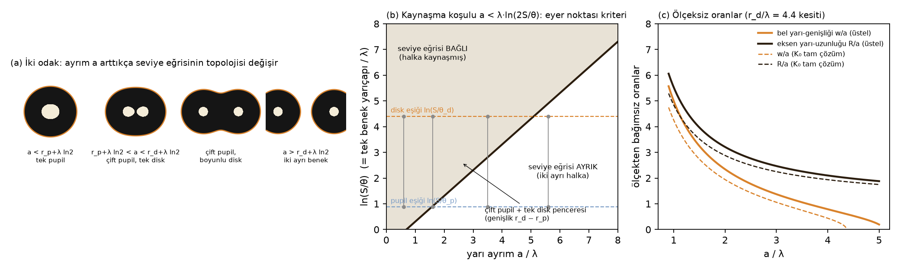
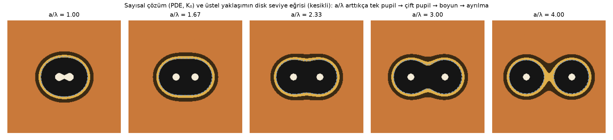

# Kelebek Göz Beneklerinde Kaynaşma Geometrisi: Difüzyon–Bozunma Modelinin Seviye Eğrileri ve Türkiye *Maniola jurtina* Popülasyonunda Ölçekten Bağımsız Sınanması

**TÜBİTAK 2204-A Lise Öğrencileri Araştırma Projeleri Yarışması — Araştırma Raporu (Taslak v3)**
Alan: Matematik (uygulama alanı: Biyoloji) · Sürüm tarihi: 7 Ekim 2026
Durum: kuram (Teorem 1–2, Önerme 3–4), sayısal doğrulama ve tek-benek ön analizi (n = 97) tamamlandı; çift pupilli benek ölçümleri **[DOLDURULACAK]**.

> Köşeli parantez içindeki **[DOLDURULACAK — …]** notları öğrencilerin kendi ölçümleriyle tamamlayacağı yerleri gösterir. Yapay zekâ desteğiyle üretilen kod ve metinler §5.6'da beyan edilmiştir. Bu sürüm, v2'nin tek-benek analizini korur ve matematiksel çekirdeği iki odaklı modelin seviye eğrilerine taşır (gerekçe: `proje-tasarimi-v3-oneri.md`).

---

## 1. Özet

**Problem.** Kelebek göz benekleri, bir odak noktasından yayılıp bozunan bir sinyalin (morfogen) eşik kuralıyla renge çevrilmesiyle oluşur; sinyal, kararlı durumda D∇²m − γm + s = 0 denklemini sağlar. Bu denklem **doğrusaldır**: iki odağın alanı, iki tek-odak çözümünün toplamıdır. Halka sınırları bu toplamın **seviye eğrileridir**. Projenin sorusu: iki odak birbirine ne kadar yaklaşınca halkalar kaynaşır, kaynaşmış beneğin biçimi nedir ve bu biçim ölçeği bilinmeyen fotoğraflardan modeli sınamaya yeter mi?

**Matematiksel sonuçlar.** Tek odak için halka yarıçapı r_i = λ·ln(S/θ_i) (λ = √(D/γ) yayılım uzunluğu, S kaynak gücü, θ_i eşik). İki odak (±a, 0) için: **(Teorem 1)** θ-seviye eğrisi bağlıdır ⟺ a < r_θ + λ·ln 2; kanıt, orta noktanın bir eyer noktası olmasına dayanır. **(Teorem 2)** Pupiller ayrık ve disk bağlı ("çift pupilli benek") ⟺ r_p + λln2 < a < r_d + λln2; pencerenin genişliği tam olarak tek benekteki halka farkı r_d − r_p'dir. **(Önerme 3)** Kaynaşmış diskin bel yarı-genişliği w² = (r_d + λln2)² − a² ve eksen yarı-uzunluğu R = r_d + λ·ln(2cosh(a/λ)); fotoğraftan ölçülen iki oran (w/a, R/a) iki boyutsuz bilinmeyeni (a/λ, r_d/λ) ölçek bilgisi olmadan belirler; pupil yarıçapı oranı veya tam kontur eklenince sistem aşırı belirli olur ve model mm ölçeği bilinmeden sınanabilir. **(Önerme 4)** Piksel ölçeğinde değişmez istatistikler sıfırıncı dereceden homojen fonksiyonlardır; oranın değişim katsayısı CV² ≈ CV_gerçek² + τ²(1/r_p² + 1/r_d²) biçiminde ayrışır.

**Sayısal ve ampirik sonuçlar.** Denklemin sonlu farklarla çözümü Teorem 1–2'nin öngördüğü topoloji değişimlerini (tek pupil → çift pupil → boyun → ayrılma) a/λ'nın tam öngörülen değerlerinde üretti; Önerme 3 ile ters çözüm r_d'yi %2, λ'yı %15 hata ile geri buldu (hata üstel yaklaşımdan kaynaklanır; K₀ tam çözümüyle azalır). iNaturalist Türkiye kayıtlarından 97 tek pupilli bireyde Önerme 4'ün varyans ayrışımı, pupil/disk oranındaki %19'luk saçılımın %17'sinin gerçek bireysel değişkenlik, yalnız 0.2 px'inin ölçüm gürültüsü olduğunu gösterdi; oran–boyut korelasyonu ρ = −0.14 ile birlikte bu, "yalnız kaynak gücü değişir" ve "pupil sabit" senaryolarını dışlayıp "yayılım uzunluğu ve eşik birlikte değişir" senaryosuyla uyumludur (Monte Carlo güç ≥ %98). Çift pupilli bireylerde Önerme 3'ün sınanması **[DOLDURULACAK]**.

**Anahtar kelimeler:** reaksiyon-difüzyon, seviye eğrisi, eyer noktası, üst üste binme ilkesi, ölçek değişmezliği, göz beneği, *Maniola jurtina*, vatandaş bilimi

---

## 2. Amaç ve Araştırma Soruları

**Amaç:** Tek ve iki odaklı difüzyon–bozunma modelinin kararlı durum çözümünün seviye eğrilerini incelemek; kaynaşma koşulunu ve kaynaşmış beneğin geometrisini kapalı biçimde türetmek; bu sonuçlardan ölçekten bağımsız, sınanabilir öngörüler çıkarmak ve Türkiye *M. jurtina* popülasyonunda sınamak.

**Araştırma soruları**
1. İki odaklı alanın seviye eğrisi hangi koşulda bağlı, hangi koşulda ayrıktır? Topoloji değişimi hangi kritik noktada olur?
2. Çift pupilli bir beneğin (iki pupil, tek disk) var olabilmesi için odak ayrımı hangi aralıkta olmalıdır; bu aralık tek beneğin halka ölçüleriyle nasıl ilişkilidir?
3. Kaynaşmış diskin biçiminden (bel genişliği, uzunluk, pupil ayrımı) λ/a ve r_d/λ ölçek bilinmeden kestirilebilir mi; pupil yarıçapı veya kontur eklenince sistem aşırı belirli olur mu?
4. Piksel ölçeğinde hangi istatistikler değişmezdir ve ölçüm gürültüsü oranın saçılımına ne kadar katkı yapar?
5. Tek pupilli bireylerde boyut ve oran değişkenliği modelin hangi parametresinden gelir?

---

## 3. Giriş

### 3.1 Model ve biyolojik dayanağı (kısa)
Nijhout (1978, 1980), göz beneğinin pupa evresinin ilk saatlerinde bir odak hücre grubundan salgılanan tek bir maddenin yayılıp bozunmasıyla oluştuğunu önerdi: ∂m/∂t = D∇²m − γm + s(x); hücreler m > θ_i ise i. pigmenti seçer. Odak hücreleri alınınca benek oluşmaz, nakledilince nakil yerinde oluşur (Nijhout 1980; French & Brakefield 1995). Monteiro vd. (2001) yakın iki odağın kaynaşmış beneklerinin dış hattının iki gradyanın toplamına uyduğunu sayısal olarak göstermiştir (doi:10.1023/a:1010226223287); moleküler karşılıklar için Connahs vd. (2019), Hanly vd. (2023). Turing'in (1952) genel reaksiyon-difüzyon kuramı ve Gray–Scott desen aileleri ek literatür raporundadır (`ARASTIRMA_RAPORU.md`).

### 3.2 Bilinenler ve boşluk
Monteiro vd. (1997) *Bicyclus*'ta halka oranlarının eşikler (θ), benek boyutunun odak sinyali üzerinden kalıtıldığını bulmuştur (doi:10.1111/j.1558-5646.1997.tb03968.x). Palmer, McKenna & Nijhout (2019) *Junonia*'da benek çaplarının kanat boyuyla izometrik ölçeklendiğini (doi:10.1093/icb/icz123), Mowbray vd. (2024) *M. jurtina*'da ön kanat beneğinin kanat uzunluğuyla ölçeklendiğini (doi:10.1002/ece3.10842) göstermiştir. Otaki (2011a) tek-morfogenli modele halka oranları açısından itiraz etmiştir (doi:10.2108/zsj.28.403). **Boşluk:** Monteiro vd. (2001) kaynaşmış kontur toplamını yalnız sayısal olarak sınadı; kaynaşma koşulunun kapalı biçimi, çift pupilli beneğin varlık aralığı ve kaynaşmış biçimden ölçeksiz parametre kestirimi literatürde yoktur. *M. jurtina*'nın apikal beneği doğada sık çift pupillidir (Thomson 1969), bu da modeli doğal popülasyonda cerrahi müdahale olmadan sınama imkânı verir.

### 3.3 Çalışılan tür
**Çayır esmeri *Maniola jurtina***: ön kanat apeksinde beyaz pupilli tek büyük siyah benek; sık çift pupilli; 0–2000 m; Mayıs–Eylül; iNaturalist Türkiye'de 390 araştırma düzeyinde kayıt. Yedek türler: *Lasiommata megera*, *Pararge aegeria* (apikal benek sık çift pupilli). **[Ö3: 1 sayfalık biyoloji notu.]**

---

## 4. Matematiksel Çerçeve

### 4.1 Doğrusallık ve üst üste binme
Kararlı durumda denklem D∇²m − γm = −s(x) doğrusal ve homojen olmayan bir eliptik denklemdir. m₁ ve m₂ sırasıyla s₁ ve s₂ kaynaklarının çözümüyse m₁ + m₂, s₁ + s₂'nin çözümüdür (üst üste binme ilkesi). Dolayısıyla iki odaklı alan, iki tek-odak alanının toplamıdır — Monteiro vd. (2001)'in "sinyaller toplanmalı" varsayımı bir varsayım değil, denklemin doğrusallığının sonucudur.

### 4.2 Tek odak: radyal çözüm ve halka yarıçapı
Dairesel simetride odak dışında D(m'' + m'/r) − γm = 0, yani değiştirilmiş Bessel denklemi; sonlu kalan çözüm m(r) = A·K₀(r/λ), **λ = √(D/γ)**. Boyut analizi: D [mm²/s] ve γ [1/s] yalnız bu birleşimde bir uzunluk verir; λ denklemin tek uzunluk ölçeğidir. K₀(x) ≈ √(π/2x)·e^(−x) asimptotuyla m(r) ≈ S·e^(−r/λ) ve

  **r_i = λ · ln(S/θ_i)**   (1)

(Şekil 1a–b). S ve θ_i yalnız ln(S/θ_i) içinde göründüğünden ayrı ayrı kestirilemez (yapısal tanımlanamazlık); kestirilebilenler λ ve ℓ_i := ln(S/θ_i) = r_i/λ'dır. Oran r_p/r_d = ℓ_p/ℓ_d λ'dan, fark r_d − r_p = λ(ℓ_d − ℓ_p) S'den bağımsızdır.

*Şekil 1. Tek odak. (a) Kararlı durum profili log ölçekte: üstel yaklaşım ve K₀ tam çözüm; eşikler profili kestiği yerde halka sınırını verir. (b) ln m = ln S − r/λ: S kesmeyi, λ eğimi değiştirir. (c) Üç tek-parametre senaryosunun (r_d, r_p) düzlemindeki doğruları.*

### 4.3 İki odak: kritik noktalar ve kaynaşma
Odaklar (±a, 0)'da, üstel yaklaşımla ve λ birimiyle (λ = 1, S = 1):

  m(x, y) = e^(−d₁) + e^(−d₂),  d_{1,2} = √((x ∓ a)² + y²).

m, odaklar dışında düzgündür ve x → ±x, y → ±y simetrilerine sahiptir. **Lemma.** Orta nokta O = (0,0) m'nin bir kritik noktasıdır ve a > 0 için **eyer noktasıdır**: x-ekseni boyunca m(x,0) O'da yerel minimum (odaklara yaklaştıkça artar), y-ekseni boyunca m(0,y) = 2e^(−√(a²+y²)) O'da maksimumdur. m'nin odaklar dışındaki tek kritik noktası O'dur (kanıt: ∇m = 0 denklemi simetriden y = 0'a indirgenir; x-ekseninde türev x = 0 dışında sıfırlanmaz).

**Teorem 1 (kaynaşma koşulu).** θ-seviye kümesi {m ≥ θ} bağlıdır ⟺ θ ≤ m(O) = 2e^(−a) ⟺

  **a < ln(2/θ) = r_θ + ln 2**   (λ birimiyle; mm'de a < r_θ + λ·ln 2),   (2)

burada r_θ = ln(1/θ) aynı eşiğin tek-odak yarıçapıdır. *Kanıt.* Üst-seviye kümesi, her odağı içeren iki bileşenin birleşimidir; iki bileşen ancak x = 0 doğrusunu kesen bir yol varsa birleşir. x = 0 üzerinde m'nin maksimumu O'da alınır (y-yönünde azalan); dolayısıyla böyle bir yol vardır ⟺ m(O) ≥ θ. Tersine m(O) < θ ise {x = 0} kümeyi ikiye ayırır. ∎ Topoloji yalnız θ = m(O) kritik değerinde değişir: "8" biçimli tek eğri iki ovale ayrılır (Şekil 2a–b).

### 4.4 Çift pupilli benek
**Teorem 2 (çift pupil penceresi).** Pupil seviye kümesi ayrık ve disk seviye kümesi bağlı ⟺

  **r_p + λ ln 2 < a < r_d + λ ln 2.**   (3)

Pencerenin genişliği **r_d − r_p**'dir — tek beneğin halka farkı. *Kanıt.* (2)'yi θ_p ve θ_d'ye uygula. ∎ Sonuçlar: (i) Çift pupilli benek yalnız bu aralıkta var olabilir; a bu aralığın altındaysa pupiller de kaynaşır ("tek büyük pupil"), üstündeyse disk ayrılır ("iki ayrı benek"). (ii) Odak ayrımı a popülasyonda rastgele dağılıyorsa çift pupil sıklığı pencere genişliğiyle, yani r_d − r_p = λ(ℓ_d − ℓ_p) ile artar: λ'sı büyük türlerde/bireylerde çift pupil daha sık beklenir — bağımsız bir öngörü.

### 4.5 Kaynaşmış diskin geometrisi ve ölçeksiz test
**Önerme 3.** Disk bağlıyken bel yarı-genişliği w (x = 0 doğrusunda sınırın y-koordinatı) ve eksen yarı-uzunluğu R (y = 0 doğrusunda sınırın x-koordinatı, R > a):

  **w² = (r_d + λ ln 2)² − a²,  R = r_d + λ · ln(2 cosh(a/λ)).**   (4)

*Kanıt.* 2e^(−√(a²+w²)/λ) = θ_d/S ve e^(−(R−a)/λ) + e^(−(R+a)/λ) = e^(−R/λ)·2cosh(a/λ) = θ_d/S eşitliklerinden, r_d = λ ln(S/θ_d) ile. ∎ Bir fotoğrafta a, w, R piksel cinsinden ölçülür; ölçek bilinmediğinden **oranlar** kullanılır. (4)'ü a'ya bölünce w/a ve R/a, iki boyutsuz bilinmeyenin — a/λ ve r_d/λ — fonksiyonlarıdır; dolayısıyla iki oran bu iki bilinmeyeni **tam olarak** belirler (her çift pupilli bireyden ölçeksiz bir λ/a ve r_d/λ kestirimi). Model sınaması, yani **aşırı belirlilik**, üç bağımsız yoldan gelir: (i) aynı benekteki pupil yarıçapı r_p' üçüncü bir oran verir — iki odaklı alanda pupil sınırı da (4)'e benzer biçimde a/λ, r_d/λ ve ℓ_p/ℓ_d'ye bağlıdır ve ℓ_p/ℓ_d tek pupilli bireylerden bağımsız olarak bilinir (≈ 0.20, §6) → üç ölçüm, iki bilinmeyen; (ii) kestirilen r_d/λ değerleri bireyler arasında sabit olmalı ve tek pupilli bireylerin ℓ_d'siyle örtüşmelidir (tek pupilli kestirim girdi olarak kullanılmaz, yalnız karşılaştırılır); (iii) kontur tümüyle ölçülürse iki parametreli (λ, r_d) seviye eğrisi onlarca kontur noktasına uydurulur ve artıklar incelenir. Şekil 2c, r_d/λ = 4.4 sabitlenmiş kesit için eğrileri gösterir. Üstel yaklaşım yerine K₀ toplamı alınırsa aynı oranlar sayısal olarak hesaplanır (Şekil 2c kesikli); iki eğri ailesi farklıdır, dolayısıyla veri yaklaşımla tam çözümü de ayırt edebilir.

*Şekil 2. İki odak. (a) Ayrım a arttıkça disk seviye kümesinin topolojisi: tek pupil → çift pupil, tek disk → boyunlu disk → iki ayrı benek. (b) Faz diyagramı: bağlılık koşulu a < λ·ln(2S/θ); pupil ve disk eşikleri arasındaki dikey aralık çift pupil penceresidir. (c) Ölçeksiz oranlar w/a ve R/a, a/λ'nın fonksiyonu olarak, r_d/λ = 4.4 kesitinde (genel durumda iki parametreli yüzeyler); düz: üstel, kesikli: K₀.*

### 4.6 Ölçek değişmezliği ve ölçüm hatası
**Önerme 4a (değişmezlik).** Fotoğraftaki uzunluklar r_px = μ·r_mm ile verilsin (μ bilinmeyen, fotoğrafa özgü). Bir istatistik f(r_p, r_d, s, …) her μ > 0 için f(μ·x) = f(x) sağlıyorsa ancak ve ancak sıfırıncı dereceden homojendir; Euler teoremi gereği Σ x_k ∂f/∂x_k = 0. Oranlar değişmezdir; farklar ve regresyon katsayıları değildir. Sonuç: piksel ölçeğinde r_p ~ r_d regresyonu, μ'nun bireyler arası değişkenliğinden dolayı mekanizmadan bağımsız olarak "orantılı" görünür (§6.4'te sayısal doğrulama).

**Önerme 4b (oranın varyansı).** Ölçülen yarıçaplar r̂ = r + ε, ε'nin varyansı τ² = σ² + h²/12 olsun (σ: algılama gürültüsü, h: nicemleme adımı, yuvarlama hatası U(−h/2, h/2)). Delta yöntemiyle, birinci mertebede

  **CV²(r̂_p/r̂_d) ≈ CV²_gerçek + τ² (1/r_p² + 1/r_d²).**   (5)

Çözünürlük katmanlarında (r_p, r_d) farklı olduğundan (5), CV²'nin q := 1/r_p² + 1/r_d²'ye karşı doğrusal regresyonuyla CV_gerçek (kesme) ve τ (eğim) olarak **veriden kestirilebilir**. Yalnız yuvarlama için h = 0.5 px → τ₀ = 0.144 px.

### 4.7 Hipotezler
**H1 (çift pupil geometrisi):** Çift pupilli bireylerin (w/a, R/a) çiftleri (4)'ün eğrisi üzerinde midir; çıkarılan a/λ değerleri (3) aralığında mıdır; kontur iki parametreli seviye eğrisine uyar mı? **H2 (tek benek değişkenliği):** r_p/r_d ile r_d/s korelasyonunun işareti ve (5) ile ayrıştırılan CV_gerçek, hangi parametre senaryosuyla uyumludur? **H3 (coğrafya):** λ vekili rakım/sıcaklıkla ilişkili midir?

---

## 5. Yöntem

### 5.1 Veri kaynağı
iNaturalist API, "research grade", Türkiye (place_id 7183), fotoğraflı gözlemler (`inat_cek.py`); rakım SRTM (Open-Elevation).

| Tür | Gözlem | Fotoğraf | Lisans (CC / lisanssız) | Rakım medyan | >1000 m | >1500 m | Aralık | Ay yoğunluğu |
|---|---|---|---|---|---|---|---|---|
| *Maniola jurtina* | 390 | 508 | 300 / 90 (%77 CC) | 108 m | 55 | 27 | 0–2144 m | May 102, Haz 133, Tem 65, Ağu 36, Eyl 43 |
| *Aglais io* | 105 | 152 | 85 / 20 (%81 CC) | 467 m | 35 | 13 | 0–2788 m | Mar–Tem |

*M. jurtina* kayıtlarının %67'si 2022–2026 yıllarına aittir. Yalnız CC lisanslı fotoğraflar analize girer (Ek A).

### 5.2 Otomatik benek ölçümü (`benek_olc.py`, `hat.py`)
Koyu, dairesel, merkezinde parlak pupil bulunan ve çevresi sıcak tonlu kanat zemini olan lekeler aday alınır; skorlama ile en iyi aday seçilir. Merkezden 0.5 px adımla 180 açı üzerinde parlaklık (L*) ve doygunluk profili çıkarılır; pupil sınırı ilk keskin düşüşün yarı-yükseklik noktası, disk sınırı sonraki keskin yükselişin yarı-yükseklik noktasıdır. Geçerlilik ölçütleri: pupil var, disk parlaklığı < 70, r_d ≥ 6 px, pupil–disk kontrastı > 90. Her fotoğraf için teşhis görseli üretilir (`veri/teshis_ornek/`) ve öğrenci doğrulamasından geçer. Altın/turuncu halka (r_g) *M. jurtina*'da güvenilir değildir (turuncu alan halka değil geniş yamadır); *A. io* için LAB b-kanalı tabanlı çok halkalı modül yazılacaktır **[Danışman]**.

### 5.3 Ölçek ve cinsiyet
Ön analizde ölçek vekili olarak benek merkezinden en yakın kanat kenarına uzaklık s (GrabCut silüeti + uzaklık dönüşümü, `silhuet_olcek.py`) kullanıldı. Aynı bireyin farklı fotoğraflarında r_d/s için ICC = 0.30 (birey-içi CV %22) bulundu; bu vekil gürültülüdür ve §6.3'te gösterildiği gibi mm ölçeğine çevrilemez. Ana analizde ön kanat uzunluğu L (taban–apeks, px) her fotoğrafta elle işaretlenir ve tür/cinsiyet ortalaması L_mm (♂ ~22 mm, ♀ ~25 mm; **[Ö3: literatürden doğrulanacak]**) ile mm'ye çevrilir. Cinsiyet: ön analizde vekil olarak silüet içindeki turuncu alan oranı; ana analizde **[Ö3 ölçütleriyle]** görsel etiket. **[Ö2: işaretleme aracı; 30 fotoğrafta iki bağımsız ölçücü, ICC > 0.8 hedefi; dahil etme: dik açı, elipslik < 1.15, benek bütün, aşınma yok.]**

### 5.4 Çift pupilli benek ölçümü — **[Danışman + Ö2]**
Otomatik hatta "çift pupilli" olarak ayrılan fotoğraflar ayrı bir kümeye alınır. Her fotoğrafta tıklama aracıyla iki pupil merkezi (→ a), diskin bel noktaları (→ w) ve eksen uçları (→ R) işaretlenir; disk konturu eşikleme ile çıkarılır. Dahil etme: dik açı (elipslik < 1.15), disk bütün, iki pupil belirgin. Hedef n ≈ 40. Ölçüm tekrarlanabilirliği iki ölçücüyle (ICC).

### 5.5 Sayısal çözüm ve sentetik doğrulama (`kanat_turing.py`, `sentetik_cift_odak.py`)
Denklem 5 noktalı sonlu fark Laplace operatörü ve açık Euler ile çözülür; kararlılık koşulu D·Δt/Δx² < 1/4 (kullanılan 0.2). İki odaklı sentetik alanlar λ = 12 px, a/λ ∈ {1, 1.67, 2.33, 3, 4} için üretilir; eşikler tek-odak çözümünde r_d = 3λ, r_p = 0.6λ verecek biçimde seçilir. Her alanda disk ve pupil kümelerinin bağlı bileşen sayısı sayılır (Teorem 1–2 sınaması), w ve R ölçülüp (4) ile λ ve r_d geri bulunur (Önerme 3 sınaması; üstel ve K₀ sürümleri).

### 5.6 İstatistik, Monte Carlo ve beyan
Tek benek: (T2) Spearman ρ(r_p/r_d, r_d/s); (5) ile varyans ayrışımı (üç çözünürlük katmanı, OLS). Monte Carlo (`monte_carlo.py`): dört üretici senaryo (yalnız λ; yalnız S; pupil sabit; λ + θ_p) × gerçekçi ölçüm gürültüsü (px/mm log-normal, τ = 0.15 px — veriden kestirilen değer —, 0.5 px nicemleme, ICC 0.31'lik ölçek vekili); 400 tekrar; T2'nin gücü ve oran CV'si. Python 3.11; NumPy, SciPy, pandas, statsmodels, OpenCV, Matplotlib. Kod ve veri çekme betikleri danışman gözetiminde yapay zekâ destekli geliştirildi; tüm ölçümlerin görsel doğrulanması, işaretlemeler ve kanıtların yazımı öğrenciler tarafından yapılır. Hiçbir kelebek yakalanmamıştır.

---

## 6. Bulgular

### 6.1 Sentetik doğrulama: Teorem 1–2 ve Önerme 3 (Şekil 3)
| a/λ | Öngörü (Teorem 2) | PDE: disk parça | PDE: pupil parça | w (px) | R (px) | λ̂ üstel | λ̂ K₀ | r̂_d |
|---|---|---|---|---|---|---|---|---|
| 1.00 | pupil bağlı, disk bağlı (a < r_p + λln2 = 15.3) | 1 | 1 | 41.5 | 49.5 | 9.2 | 10.3 | 36.9 |
| 1.67 | çift pupil, disk bağlı | 1 | 2 | 38.5 | 56.5 | 10.2 | 11.7 | 36.3 |
| 2.33 | çift pupil, disk bağlı | 1 | 2 | 32.5 | 64.5 | 9.3 | 10.4 | 36.5 |
| 3.00 | çift pupil, disk bağlı (a < r_d + λln2 = 44.3) | 1 | 2 | 24.5 | 72.5 | 10.2 | 11.6 | 36.5 |
| 4.00 | iki ayrı benek (a = 48 > 44.3) | 2 | 2 | — | — | — | — | — |

Gerçek değerler: λ = 12 px, r_d = 36 px, r_p = 7.2 px. Bağlı bileşen sayıları beş durumda da Teorem 1–2'nin öngörüsüyle aynıdır; pupil kaynaşması a/λ = 1.00'de (eşik 1.28) gerçekleşmiş, 1.67'de gerçekleşmemiştir; disk ayrılması 3.00 ile 4.00 arasında (eşik 3.69) olmuştur. Önerme 3 ile ters çözüm r_d'yi %1–2 hatayla, λ'yı üstel formülle %15–24, K₀ ile %3–14 düşük geri bulmuştur; sapma, üstel yaklaşımın K₀'a göre yavaş azalması ve piksel sınır nicemlemesinden kaynaklanır. Şekil 3'te üstel yaklaşımın seviye eğrisi (kesikli) PDE çözümünün disk sınırıyla büyük ölçüde çakışır.

*Şekil 3. İki odaklı denklemin sonlu fark çözümü (λ = 12 px) ve üstel yaklaşımın disk seviye eğrisi (kesikli). Soldan sağa a/λ = 1, 1.67, 2.33, 3, 4: tek pupil → çift pupil → boyunlu disk → iki ayrı benek; topoloji değişimleri Teorem 1–2'nin eşiklerinde gerçekleşir.*

### 6.2 Tek benek: hat verimi ve ölçüm
395 CC lisanslı fotoğraf → 249 tespit → 154 geçerli → geometri filtresi ve birey tekilleştirme → **n = 97 birey** (rakım 0–2144 m; 0–200 m 39, 200–800 m 26, 800–1500 m 17, >1500 m 15). Pupil yarıçapı medyan 2.5 px (1–7), disk 12.5 px (6.5–34). Çift pupilli olduğu için elenen fotoğraf sayısı **[DOLDURULACAK — hattan sayılacak]**.

### 6.3 Tek benek: ölçekten bağımsız oran testi ve varyans ayrışımı (Şekil 4–5)

*Şekil 4. n = 97, piksel ölçeği, s = ölçek vekili. (a) r_p–r_d ve üç kısıtlı model (yalnız gösterim amaçlı; §4.6a gereği bilgi taşımaz). (b) Ölçekten bağımsız test. (c) Göreli benek boyu ile rakım.*

- r_p/r_d = 0.203 ± 0.039 (CV 0.194). ρ(r_p/r_d, r_d/s) = −0.14 (p = 0.17); r_d ≥ 15 px alt kümesinde ρ = −0.29 (p = 0.10).
- **Varyans ayrışımı (Önerme 4b):** üç çözünürlük katmanında CV = 0.202 / 0.193 / 0.175 (q = 0.312 / 0.155 / 0.085 px⁻²); CV² ~ q regresyonu (r = 0.92): **CV_gerçek = 0.169, τ = 0.21 px**. τ, yalnız yuvarlamanın verdiği 0.144 px'e yakındır: algılama gürültüsü küçüktür (σ ≈ 0.15 px) ve **oran saçılımının büyük kısmı gerçek bireysel değişkenliktir**; önceki sürümde varsayılan σ = 0.5 px (CV katkısı 0.21) veriyle bağdaşmaz (Şekil 5c).

*Şekil 5. (a) Ölçülen pupil yarıçapları. (b) r_p/r_d, r_d'ye karşı: saçılım çözünürlükle daralmıyor. (c) CV'nin q = 1/r_p² + 1/r_d²'ye karşı grafiği ve (5)'in uyumu; kesme CV_gerçek, eğim τ².*

### 6.4 Monte Carlo: dört senaryonun izleri (Şekil 6)
τ = 0.15 px ile, n = 97 / 150:

| Senaryo | T2 ρ ortalaması | T2 anlamlı | Oran CV | Pupilsiz birey | Gözlemle uyum (ρ = −0.14, CV 0.19) |
|---|---|---|---|---|---|
| Yalnız S | **+0.45** | %99 / %100 | 0.39 | %16 | ✗ (işaret ve CV) |
| Yalnız λ | −0.01 | %6 / %6 | **0.09** | 0 | ✗ (CV çok küçük) |
| Pupil sabit | **−0.53** | %100 / %100 | 0.22 | 0 | ✗ (ρ çok negatif) |
| λ + θ_p | −0.01 | %4 / %7 | **0.19** | 0 | ✓ |

Piksel ölçeğinde kısıtlı-model AIC karşılaştırması dört senaryoda da "orantılı" modeli seçmiştir (%82–100) — Önerme 4a'nın sayısal doğrulaması. Duyarlılık (r_d CV 0.12–0.30; σ = 0.5 px): sonuçların işareti değişmez (`veri/monte_carlo_duyarlilik.csv`).

*Şekil 6. (a) Dört senaryoda küçük ve büyük bireyde beklenen halkalar. (b) Oran testinin ortalama ρ'su; kesikli çizgi gözlenen değer. (c) Doğru modeli seçme olasılığı: piksel ölçeğinde (T1) ve mm ölçeğinde elle L ile (T3).*

### 6.5 H3 ön bakışı
r_d/s ~ rakım: +0.018 / 1000 m (p = 0.18, n = 97); cinsiyet vekili ve ay eklenince R² = 0.04; r_p/r_d rakımla ilişkisiz (p = 0.24). r = 0.3 büyüklüğünde bir etki için n ≈ 85 gerekir; ölçek gürültüsü (ICC 0.30) etkin n'yi düşürür. Etki varsa küçüktür.

### 6.6 Çift pupilli benekler — **[DOLDURULACAK — ana veri]**
[n çift pupilli birey; (w/a, R/a) → (a/λ, r_d/λ) kestirimleri; r_d/λ'nın bireyler arası sabitliği ve tek pupilli ℓ_d ile karşılaştırma; pupil yarıçapı oranıyla aşırı belirlilik testi; a/λ'nın (3) aralığında olup olmadığı; kontur uyumu (üstel vs K₀); çift pupil sıklığı ile r_d − r_p ilişkisi; ICC.]

### 6.7 Ölçüm güvenilirliği ve elle ölçek — **[DOLDURULACAK — Ö2]**

---

## 7. Tartışma

### 7.1 Matematiksel katkı
Üç sonuç modelden türetilmiş kesin ifadelerdir. (i) Kaynaşma kriteri a < r_θ + λln2, eyer noktası argümanıyla kanıtlanır ve λln2 ≈ 0.69λ'lık bir "kaynaşma payı" verir: iki benek, yarıçapları toplamından daha uzakta olsalar bile sinyal toplamı yüzünden kaynaşır. (ii) Çift pupil penceresinin genişliğinin r_d − r_p olması, tek beneğin halka farkını iki odaklı geometriye bağlar; v2'de sabit-fark senaryosunun test istatistiği olan nicelik burada bir varlık aralığının genişliği olur. (iii) Önerme 3, ölçek bilgisi olmadan a/λ ve r_d/λ'yı belirler ve üçüncü bir ölçümle (pupil yarıçapı, kontur) model sınamasına izin veren aşırı belirli bir sistem verir; Önerme 4, piksel verisinde hangi istatistiklerin anlamlı olduğunu karakterize eder ve gürültünün katkısını veriden kestirir. Bu sonuçlar lise matematiğiyle (üstel ve logaritma, iki değişkenli fonksiyonun kritik noktaları, Euler homojenlik teoremi, delta yöntemi) türetilebilir; K₀ ile tam çözüm sayısal karşılaştırma için kullanılmıştır.

### 7.2 Sayısal ve ampirik sonuçların yorumu
Sentetik doğrulama, Teorem 1–2'nin topoloji öngörülerinin PDE çözümünde tam olarak gerçekleştiğini gösterir; Önerme 3 r_d'yi doğru, λ'yı üstel yaklaşımdan dolayı sistematik düşük bulur — gerçek veride K₀ sürümü kullanılmalıdır. Tek benek verisinde Önerme 4b, önceki yorumu düzeltmiştir: oran saçılımı ölçüm gürültüsü değil, gerçek bireysel değişkenliktir (CV_gerçek ≈ 0.17). ρ ≈ −0.14 ile birlikte bu, dört senaryodan yalnız "λ + θ_p" ile uyumludur: benek **boyutu** yayılım uzunluğu üzerinden, halka **oranı** eşikler üzerinden değişmektedir. Bu, Monteiro vd. (1997)'in *Bicyclus*'ta bulduğu iş bölümünün ("boyut → odak sinyali, oranlar → doku eşikleri") doğal popülasyonda ve cerrahi müdahalesiz bir karşılığıdır; λ'nın boyutla ölçeklenmesi Palmer vd. (2019) ve Mowbray vd. (2024)'ün izometri bulgularıyla tutarlıdır. Teorem 2'nin sonucu (ii) ile birleşince sınanabilir bir öngörü doğar: büyük bireylerde çift pupil daha sık olmalıdır.

### 7.3 Sınırlılıklar
(1) Üstel yaklaşım K₀'ın büyük-r asimptotudur; pupil yarıçapında (r/λ ≈ 0.6–0.9) sapma vardır — oran ve topoloji sonuçlarının işareti değişmez, λ kestirimi kayar. (2) Kaynaşma teoremi iki eş kaynak gücü için verilmiştir; farklı güçlü odaklar için eyer noktası kayar, kriter sayısal olarak hesaplanmalıdır (ileri çalışma). (3) Pupil 1–7 px ile ölçülür; çift pupil ölçümleri yüksek çözünürlüklü alt kümeyle sınırlanmalıdır. (4) Ölçek vekili s gürültülüdür (ICC 0.30); λ'yı mm cinsinden kestirmek için elle L gerekir. (5) Model kararlı durum ve sabit alan varsayar; desen büyüyen kanatta belirlenir. (6) Vatandaş fotoğraflarının açı/odak değişkenliği, cinsiyetin vekille belirlenmesi, rakım–mevsim iç içeliği. (7) Monte Carlo'nun px/mm dağılımı varsayımdır.

**[DOLDURULACAK — çift pupil verisi sonrası: Önerme 3 sınaması, üstel/K₀ ayrımı, çift pupil sıklığı.]**

---

## 8. Sonuç ve Öneriler

Doğrusal difüzyon–bozunma modelinin iki odaklı seviye eğrileri için kaynaşma koşulu, çift pupil penceresi ve kaynaşmış biçimin kapalı geometrisi türetilmiş; sayısal çözümle doğrulanmış; ölçek bilgisi gerektirmeyen bir sınama tasarlanmıştır. Tek benek verisinde varyans ayrışımı ve oran testi, *M. jurtina*'da boyut değişkenliğinin yayılım uzunluğu, oran değişkenliğinin eşikler üzerinden geldiğini göstermektedir. **[DOLDURULACAK — çift pupil sonucu.]**

**Sonraki adımlar:** (1) Çift pupilli fotoğrafların işaretlenmesi (hedef n ≈ 40) ve Önerme 3 testi; K₀ sürümüyle λ kestirimi. (2) Çift pupil sıklığı ~ benek boyutu (Teorem 2 sonucu ii). (3) Elle L ile mm ölçeği ve H3. (4) Farklı kaynak güçleri için kaynaşma kriterinin genelleştirilmesi; *A. io*'da üç halkayla eşik–yarıçap doğrusallığı. (5) Kod ve verinin açık paylaşımı.

---

## 9. Kaynakça

**Kuram**
- Turing, A. M. (1952). The chemical basis of morphogenesis. *Phil. Trans. R. Soc. B*, 237, 37–72. https://doi.org/10.1098/rstb.1952.0012
- Gierer, A. & Meinhardt, H. (1972). A theory of biological pattern formation. *Kybernetik*, 12, 30–39. https://doi.org/10.1007/BF00289234
- Pearson, J. E. (1993). Complex patterns in a simple system. *Science*, 261, 189–192. https://doi.org/10.1126/science.261.5118.189
- Kondo, S. & Miura, T. (2010). Reaction-diffusion model as a framework for understanding biological pattern formation. *Science*, 329, 1616–1620. https://doi.org/10.1126/science.1179047
- Murray, J. D. (2003). *Mathematical Biology II*, 3. baskı, Springer, Böl. 3.

**Göz beneği modelleri ve deneyleri**
- Nijhout, H. F. (1978). Wing pattern formation in Lepidoptera: a model. *J. Exp. Zool.*, 206, 119–136. https://doi.org/10.1002/jez.1402060202
- Nijhout, H. F. (1980). Pattern formation on lepidopteran wings: determination of an eyespot. *Dev. Biol.*, 80, 267–274. https://doi.org/10.1016/0012-1606(80)90403-0
- Nijhout, H. F. (1990). A comprehensive model for colour pattern formation in butterflies. *Proc. R. Soc. B*, 239, 81–113. https://doi.org/10.1098/rspb.1990.0009
- Nijhout, H. F. (1991). *The Development and Evolution of Butterfly Wing Patterns*. Smithsonian Institution Press.
- French, V. & Brakefield, P. M. (1995). Eyespot development on butterfly wings: the focal signal. *Dev. Biol.*, 168, 112–123. https://doi.org/10.1006/dbio.1995.1065
- Monteiro, A., Brakefield, P. M. & French, V. (1997). Butterfly eyespots: the genetics and development of the color rings. *Evolution*, 51, 1207–1216. https://doi.org/10.1111/j.1558-5646.1997.tb03968.x
- Brakefield, P. M. (1998). The evolution–development interface and advances with the eyespot patterns of *Bicyclus* butterflies. *Heredity*, 80, 265–272. https://doi.org/10.1046/j.1365-2540.1998.00366.x
- Monteiro, A., French, V., Smit, G., Brakefield, P. M. & Metz, J. A. J. (2001). Butterfly eyespot patterns: evidence for specification by a morphogen diffusion gradient. *Acta Biotheoretica*, 49, 77–88. https://doi.org/10.1023/a:1010226223287
- Dilão, R. & Sainhas, J. (2004). Modelling butterfly wing eyespot patterns. *Proc. R. Soc. B*, 271, 1565–1569. https://doi.org/10.1098/rspb.2004.2761
- Otaki, J. M. (2011a). Color-pattern analysis of eyespots in butterfly wings: a critical examination of morphogen gradient models. *Zoological Science*, 28, 403–413. https://doi.org/10.2108/zsj.28.403
- Otaki, J. M. (2011b). Generation of butterfly wing eyespot patterns: a model for morphological determination of eyespot and parafocal element. *Zoological Science*, 28, 817–827. https://doi.org/10.2108/zsj.28.817
- Sekimura, T., Venkataraman, C. & Madzvamuse, A. (2015). A model for selection of eyespots on butterfly wings. *PLoS ONE*, 10, e0141434. https://doi.org/10.1371/journal.pone.0141434
- Palmer, R., McKenna, K. Z. & Nijhout, H. F. (2019). Morphological murals: the scaling and allometry of butterfly wing patterns. *Integr. Comp. Biol.*, 59, 1281–1289. https://doi.org/10.1093/icb/icz123
- Connahs, H. vd. (2019). Activation of butterfly eyespots by *Distal-less* is consistent with a reaction-diffusion process. *Development*, 146, dev169367. https://doi.org/10.1242/dev.169367
- Liao, K.-L. vd. (2021). Mathematical modeling of the eyespots in butterfly wings. *J. Theor. Biol.*, 531, 110898. https://doi.org/10.1016/j.jtbi.2021.110898
- Otaki, J. M. (2021). The fractal geometry of the Nymphalid groundplan. *Insects*, 12, 39. https://doi.org/10.3390/insects12010039
- Mazo-Vargas, A. vd. (2017). Macroevolutionary shifts of WntA function potentiate butterfly wing-pattern diversity. *PNAS*, 114, 10701–10706. https://doi.org/10.1073/pnas.1708149114
- Hanly, J. J. vd. (2023). Frizzled2 receives WntA signaling during butterfly wing pattern formation. *Development*, 150, dev201868. https://doi.org/10.1242/dev.201868

***Maniola jurtina* ve vatandaş bilimi**
- Mowbray, S., Bennie, J., Rhodes, M. W., Smith, D. A. S. & ffrench-Constant, R. H. (2024). Eyespot variation and field temperature in the Meadow Brown butterfly. *Ecology and Evolution*, 14, e10842. https://doi.org/10.1002/ece3.10842
- Klenovšek, T., Jakšić, P. & Janžekovič, F. (2025). Eyespot variation in the Meadow Brown butterfly, *Maniola jurtina* (Insecta: Lepidoptera) in diverse climatic conditions. *Diversity*, 17(10), 675. https://doi.org/10.3390/d17100675
- Drury, J. P. vd. (2019). Continent-scale phenotype mapping using citizen scientists' photographs. *Ecography*, 42, 1436–1445. https://doi.org/10.1111/ecog.04469
- Thomson, G. (1969). Maniola jurtina ssp. insularis; aktaran UK Butterflies, https://ukbutterflies.co.uk/species.php?species=jurtina

**Türkiye kelebekleri**
- Baytaş, A. (2018). *Türkiye'nin Kelebekleri Arazi Rehberi*. Doğa Koruma Merkezi, Ankara.
- Karaçetin, E. & Welch, H. J. (2011). *Türkiye'deki Kelebeklerin Kırmızı Kitabı*. Doğa Koruma Merkezi, Ankara.
- iNaturalist (https://www.inaturalist.org); Open-Elevation (SRTM); kelebekler.org; TRAKEL.

---

---

## Ekler

- **A.** Kullanılan fotoğrafların gözlemci–lisans listesi: `veri/ek_a_lisans_listesi.csv` (97 birey; CC-BY-NC 85, CC-BY 5, CC0 3, CC-BY-NC-SA 1, CC-BY-NC-ND 3; ND lisanslılar yalnız ölçümde kullanılmıştır).
- **B.** Kanıtların tam yazımı (Lemma, Teorem 1–2, Önerme 3–4) **[Ö1 — tahtada anlatılabilir biçimde]**
- **C.** Ölçüm protokolü v2 (tek benek ve çift pupil) **[Ö2]**
- **D.** Kod ve veri: `kanat_turing.py`, `inat_cek.py`, `benek_olc.py`, `silhuet_olcek.py`, `hat.py`, `analiz.py`, `monte_carlo.py`, `sekil_gradyan.py`, `sekil_cift_odak.py`, `sentetik_cift_odak.py`, `sekil_oran.py`, `rapor_pdf.py`; `veri/*.csv`; `sekiller/`
- **E.** Monte Carlo ve sentetik doğrulama tabloları: `veri/monte_carlo_sonuc.csv`, `veri/monte_carlo_duyarlilik.csv`, `veri/sentetik_cift_odak.csv`, `veri/oran_varyans_uyum.csv`
- **F.** Çalışma günlüğü **[tüm ekip]**
